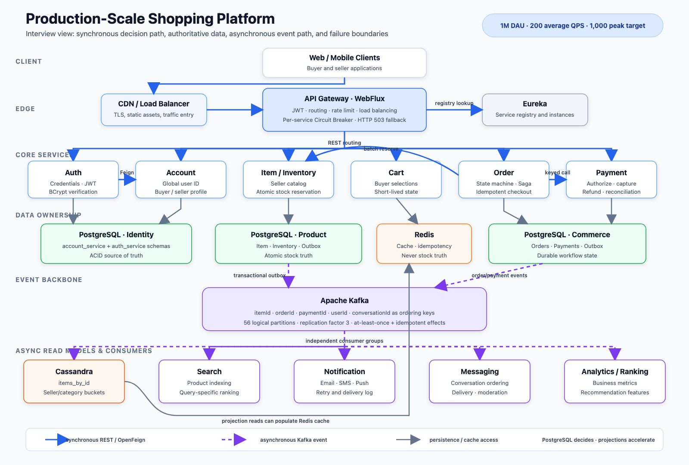

# Java 电商微服务面试问答 V2 中文对照学习版

本文件对应 [INTERVIEW_QA_V2.md](INTERVIEW_QA_V2.md)，共有 41 章，新增第 39–41 章与英文版对应。它是按章对应的中文学习版，不是逐句机械翻译；重复解释适当合并，技术名词、关键公式、业务规则和故障处理保留，方便先用中文理解，再回英文版练习表达。章节中的 Page 是学习编号，不是打印后的实际页码。

本文讨论完整目标架构，同时保留英文版中对现有实现、设计方案和计算示例的区分。百万日活、200 平均 RPS、1,000 峰值 RPS、每日 80,000 单、峰值每秒 50 单及平均每单四行，都是容量模型输入，不是通过本文证明的线上成绩。方法名和配置值沿用英文底稿的说明，本次没有重新运行应用来验证所有现状。

## 如何对照学习

### 完整架构的统一数字口径

以下规模统一用于本次扩展的 PostgreSQL、Kafka、Redis、幂等和搜索章节。它们是可用于容量推演和测试的设计输入，而不是实测提升百分比；旧调试案例只用于解释问题，不限制完整架构的范围。

| 项目 | 统一设定与含义 |
|---|---|
| 用户与目录 | 1M DAU，累计 10M 账户，1M 在售商品；用户总量不等于日活 |
| HTTP | 平均 200 RPS，规划峰值 1,000 RPS；不是 Kafka 消息数或 SQL 次数 |
| 商品与搜索入口 | 峰值 650 RPS，其中商品浏览 500、关键词搜索 150；内部批量加载另计 |
| 订单 | 80,000 单/天，平均约 0.93 单/秒，促销峰值 50 单/秒，平均四个商品行 |
| 行为事件 | 20M/天，平均约 231/s，十倍峰值约 2,315/s；采集允许批量上报 |
| 商品更新 | 峰值预算 500 事件/s，包含批量卖家导入；不是全天恒定写入 |
| API 延迟目标 | 商品/搜索 p95 < 200ms、p99 < 500ms；持久化下单受理 p95 < 300ms，不含完成支付 |
| 投影新鲜度目标 | 正常负载下 99% 商品变更五秒内可见；积压故障时单独告警，不承诺强一致 |

例如平均每天 80,000 单并不意味着全天每秒 50 单，峰值只维持部分时间。章节中的 700 商品读/s 是额外的缓存压力测试场景，不是与上表同时相加的入口流量；实例数、线程数和分片数是测试起点，必须一起验证尾延迟、错误率和故障后容量。

先读每章的主要回答，确定自己能解释“是什么、在项目哪里用、为什么用、失败后怎么办”，再读追问。英文版相同 Page 编号就是对应内容；不必先背英文长句，再猜它是什么意思。遇到数字，先算清楚单位和条件，不要把调用次数、每秒请求数、同时运行的请求数和响应时间混为一谈。

## 章节目录

1. [项目介绍](#page-1)
2. [主要数据流程](#page-2)
3. [Spring、Spring Boot 与 Spring Cloud](#page-3)
4. [IoC、依赖注入与 Bean 生命周期](#page-4)
5. [AOP 与 Spring 代理](#page-5)
6. [REST、OpenFeign、gRPC 与服务发现](#page-6)
7. [WebFlux Gateway、负载均衡与熔断](#page-7)
8. [JWT、Auth、Account 与全局身份](#page-8)
9. [PostgreSQL、Hibernate、索引与查询](#page-9)
10. [本地事务、隔离级别与库存并发](#page-10)
11. [Transactional Outbox](#page-11)
12. [Kafka 分区、消息键与可靠消费](#page-12)
13. [Cassandra 分区、分桶与一致性](#page-13)
14. [Redis 缓存、幂等与 DAU](#page-14)
15. [多线程、线程池与 CompletableFuture](#page-15)
16. [订单并发处理与幂等](#page-16)
17. [Saga 与业务补偿](#page-17)
18. [超时、重试、熔断、隔离与限流](#page-18)
19. [性能调优与数字解释](#page-19)
20. [监控、日志、追踪与告警](#page-20)
21. [Eureka、Docker、Kubernetes 与部署](#page-21)
22. [单元、集成、性能与故障测试](#page-22)
23. [项目中的设计模式](#page-23)
24. [快速深入追问](#page-24)
25. [项目总结与数字速查](#page-25)
26. [订单状态机与完整生命周期](#page-26)
27. [库存预留与支付幂等](#page-27)
28. [订单事件、重试与死信](#page-28)
29. [商品与购物车缓存故障处理](#page-29)
30. [Access Token、Refresh Token 与资源归属](#page-30)
31. [WebClient 与第三方支付容错](#page-31)
32. [可观测性与故障排查](#page-32)
33. [数据库迁移、发布与 Gateway 容量](#page-33)
34. [可靠性验收与面试准备](#page-34)
35. [Elasticsearch 商品关键词搜索](#page-35)
36. [AI 购物助手、Milvus 与 Agent](#page-36)
37. [AWS 网络、权限、存储与恢复](#page-37)
38. [Docker 与 Kubernetes 发布操作](#page-38)
39. [CI/CD：从代码提交到 AWS/EKS 发布](#page-39)
40. [Spring Security：登录、JWT 过滤链与权限](#page-40)
41. [Logging：SLF4J、Logback、OpenTelemetry 与 Splunk](#page-41)

第 39–41 章把以前零散的发布、安全和日志说明整理成独立实现专题，按完整平台架构讲解，不是对当前代码或部署的审计。数字是示例预算；新章节中英文内容对应，原有中文扩展章节与英文旧稿的差异仍保留。

## 14 条简历职责对照

本次复核另外补充了[订单链路场景核对表](#scenario-audit)，用于检查“规则、存储、失败恢复、验收”是否都能解释。完整平台的 Cassandra 九张查询表及容量方案见第 13 章，Redis key、内容和 TTL 清单见第 14 章；保留原 38 章编号，方便继续对照英文版。第 13 章现已扩展为架构案例，不再是英文原稿或当前代码的一对一盘点。

| 简历条目 | 学习时要讲清楚的内容 | 对应章节 |
|---|---|---|
| 1. Java/Spring 微服务与接口 | 服务边界、REST、Feign、Eureka、Gateway | 3、6、7、21 |
| 2. 订单管理 | 创建、支付、发货、取消、退款和用户看到的进度 | 2、17、26 |
| 3. 库存管理 | 补货、预留、释放、并发竞争与重复请求 | 9、10、27 |
| 4. 支付与退款 | 幂等、结果未知、WebClient、Resilience4j | 27、31 |
| 5. Kafka | 发布、消费、去重、重试、死信和重放 | 11、12、28 |
| 6. 数据建模 | Hibernate、PostgreSQL 权威数据、Cassandra 投影 | 9、10、13 |
| 7. Redis | 商品、卖家列表、订单缓存及实际序列化故障 | 14、29 |
| 8. Elasticsearch | 关键词、过滤、索引更新、当前商品资料 | 35 |
| 9. 多线程 | 并行读取、有界队列、下游压力和事务边界 | 15、16 |
| 10. 安全 | 身份验证、过滤链、角色、会话刷新和数据归属 | 8、30、40 |
| 11. AWS | 云资源、网络、权限、持久化与恢复 | 37 |
| 12. Docker/Kubernetes | 镜像、探针、CI/CD 关卡、滚动发布 | 21、33、38、39 |
| 13. 测试 | 并发、重复执行、真实组件与故障注入 | 22、34 |
| 14. AI 推荐 | 分块、向量、Milvus、工具调用、对话与评测 | 36 |

<a id="page-1"></a>
# Page 1 — 项目介绍

## 面试官可能问什么

“介绍一下你的项目。”“系统解决什么问题？”“你负责哪部分？”回答先讲用户和业务，再讲技术，不要开头就列十几个中间件。

## 主要回答

这是一个面向买家和卖家的 Java/Spring Boot 电商平台。买家注册登录、浏览商品、管理购物车、下单付款并查询订单；卖家管理自己的商品、价格、库存与履约。完整架构包括 Gateway、Auth、Account、Item/Inventory、Cart、Order、Payment、Search、Notification、Messaging 和 Recommendation 等业务边界，不意味着这些职责必须全部独立部署。

PostgreSQL 保存账户、商品写入、库存、订单、支付和 outbox 等权威记录。Cassandra 保存按查询组织的商品副本，Redis 缓存热点结果，Kafka 把已经提交的业务变化传递给投影、搜索和其他下游。最重要的边界是：快速读取的数据不能代替交易决策，结账不能仅凭 Redis 中的库存显示批准购买。



图中同步调用负责需要立即知道结果的操作，事件负责可以延后处理的投影、索引和通知。图是原英文版的架构概览；新增的 Elasticsearch 与 Milvus 分别在第 35、36 章展开，不能把图中每个组件当成当前已运行的部署清单。

## 数字怎样解释

假设平均 200 次 API 请求/秒，一天是 `200 × 86,400 = 17,280,000` 次。以 100 万 DAU 计算，每位活跃用户平均约 17.28 次请求/天；五倍峰值假设对应 1,000 RPS。一个可用的入口流量预算是商品/搜索 650、账户/认证 100、购物车 100、订单/支付相关 API 100、其他 50。订单/支付的 100 RPS 可以进一步分成创建订单 50、状态查询 30、支付/取消等操作 20；这是同一时段的示例预算，内部调用和支付商回调另计，不把 50 单/秒误当成整条购买流程只有 50 次 HTTP 请求。

## 深入追问

**为什么用微服务？** 商品读取量大，订单关注状态与事务，支付有更严格的审计要求，通知可以异步处理。独立边界有利于发布和扩缩容，但代价是网络超时、重复消息和跨服务恢复；只有独立职责带来的收益值得这些成本时才拆分。

**如何避免分布式单体？** 不让所有服务共用业务表，不让每个请求依赖很长的同步链，也不要求所有服务同时发布。**非功能目标是什么？** 无超卖、无重复扣款、重要后台工作不因重启丢失，以及可观测、有限的读模型延迟；p99 与吞吐目标必须通过实际测试才成为成绩。

<a id="page-2"></a>
# Page 2 — 主要数据流程

## 注册、登录与统一身份

注册由 Auth 接收，调用 Account 创建资料并取得统一 userId，Auth 使用同一个 ID 保存密码哈希和身份信息。登录时 Auth 验证本地凭证并签发 JWT，不必每次再查询 Account。这样商品所有者和订单买家都可以使用同一身份编号，而不是拿可变邮箱当主键。

Auth 与 Account 的写入不属于一个普通本地事务。Account 成功而 Auth 失败时，要靠注册操作身份、待完成状态和重试核对恢复，不能宣称 `@Transactional` 自动回滚远程 Account。

## 卖家创建商品

```text
卖家请求 → Item Service → PostgreSQL 本地事务
                         ├─ 商品记录
                         ├─ 初始库存
                         └─ 待发 outbox 事件
提交后 → publisher → Kafka → 商品投影消费者 → Cassandra 更新与缓存失效
```

这条流程把“商品已经保存”和“这个变化需要被发布”一起落库。Kafka 暂时不可用时，事件仍留在数据库；商品写入结果不会因为消息服务故障直接消失，但下游查询可能暂时滞后，需要监控积压。

## 买家下单

完整异步方案先验证身份和 Idempotency-Key，保存待处理订单及命令，再由持久化工作流预留库存、处理支付并推进状态。HTTP 可以返回 202 和查询地址；它只表示可靠受理，不表示付款完成。当前同步下单与这个目标流程要分清，单纯 `@Async` 任务只在 JVM 中，服务重启可能丢失。

**为什么不全部同步？** 如果四个必须依赖的系统各有 99.9% 可用性，在独立故障的简化假设下组合约为 `0.999⁴ = 99.6006%`。通知和统计不应延长结账关键路径。**客户端超时怎么办？** 超时代表未知结果，重试使用同一业务编号，先找到原记录，不能再创建新订单或新扣款。

<a id="page-3"></a>
# Page 3 — Spring、Spring Boot 与 Spring Cloud

## 主要回答

Spring 是 Java 应用框架，核心包括 IoC 容器和 AOP。容器创建并连接对象，AOP 在方法周围统一执行事务、缓存等行为；其他能力包括 Web、数据访问、校验、安全、消息和测试。Spring Boot 在此基础上提供 starter、条件自动配置、内嵌服务器、外部配置和 Actuator，使一个服务更容易构建和运行。

Spring Cloud 关注分布式服务，例如 Gateway、Eureka、OpenFeign、LoadBalancer 和 Circuit Breaker。本项目每个应用通过 `@SpringBootApplication` 启动，容器扫描组件、创建 Bean、注入依赖，再安装相应的事务、缓存和客户端代理。

## 自动配置到底做了什么

Boot 根据 classpath、配置和已有 Bean 决定是否启用某项配置。例如具备 JPA 和数据源条件时，创建相关基础设施；具备 Eureka client starter 时，可以通过自动配置启用客户端，不必只靠 `@EnableEurekaClient`。遇到配置不生效，应看条件报告和依赖树，不是反复添加注解。

**`@SpringBootApplication` 是什么？** 它结合应用配置、自动配置和组件扫描；扫描路径取决于启动类所在包。**Starter 是什么？** 一组常用依赖及约定，不代表不再需要检查版本兼容性。**不同 stereotype 注解有什么作用？** `@Service` 表示业务职责，`@Repository` 标识持久化并支持异常转换，`@RestController` 参与 Web 请求映射。

**Spring 本身提高 QPS 吗？** 不自动提高。价值首先是统一资源生命周期、配置和可测试性，连接池与共享客户端可以减少浪费，但性能仍然要看实际调用和数据访问。

<a id="page-4"></a>
# Page 4 — IoC、依赖注入与 Bean 生命周期

## 主要回答

IoC，即控制反转，指业务类不再负责创建和寻找全部协作者，而是声明所需依赖，由容器提供。Dependency Injection 是实现这种协作的一种方式。例如 OrderService 通过构造器取得 ItemClient 和 Repository，测试时可以替换成 mock，不需要启动整个服务网络。

构造器注入把必需依赖写清楚，支持 final 字段，也避免对象创建后还缺某个关键成员。相比字段注入，它更容易直接构造并测试。依赖注入解决对象组织问题，不会自动修复错误的服务职责划分。

## 生命周期与线程安全

Spring 读取 Bean 定义、解析依赖、实例化对象并执行初始化处理，某些后处理器会包装事务或缓存代理。运行结束时执行销毁回调，关闭受管理资源。注入给调用方的对象可能是代理，所以通过容器调用与在同一对象里 `this.method()` 调用可能不同。

Singleton 通常是每个 ApplicationContext 一个实例，不是整个集群只有一个。Spring 不会自动把它变成线程安全对象；服务通常应无状态，把用户、订单和累加变量放在方法局部，而不是保存到共享成员字段。局部引用指向共享可变对象时仍要注意并发，不是所有局部变量都天然隔离。

**循环依赖怎么办？** 构造器循环通常暴露职责混乱，可以拆出第三个组件、改变依赖方向或改成事件，不要只用懒加载掩盖。**对运维有什么帮助？** 容器统一管理连接池、HTTP 客户端和执行器，避免每个请求重复创建昂贵资源。

<a id="page-5"></a>
# Page 5 — AOP 与 Spring 代理

## 主要回答

AOP 是把很多方法都需要的外围行为集中处理，例如开启事务、查询缓存、测量耗时和记录日志。Spring 在真实对象前放一层代理，调用经过代理时，它先执行额外逻辑，再决定是否调用业务方法，最后处理返回值或异常。注解只是配置标记，真正干活的是 interceptor 等基础设施。

例如创建商品方法只写保存 Item、Inventory、Outbox，事务代理负责开始、提交或回滚。`@Cacheable` 命中时甚至不用执行原方法；`@CachePut` 每次执行原方法再更新缓存；`@CacheEvict` 删除可能过期的结果。它们减少重复代码，但并不意味着一加注解就没有一致性问题。

## 项目中的例子与术语

英文底稿指出 `Common/aop/LoggingAspect.java` 存在自定义切面，但 Common 未加入当前根构建和服务依赖，因此代码存在不代表运行中自动启用。统一日志需要确保模块导入与扫描生效，也要避免把密码、token、地址和支付资料序列化进日志。

Aspect 是封装横切行为的模块，join point 是可拦截的执行点，pointcut 选择哪些方法，advice 是前置、后置、环绕或异常处理逻辑。了解术语以后，仍然应该用“创建商品周围统一开启事务”这样的例子解释，而不是只背定义。

## 深入追问

**Self-invocation 为什么失效？** 同一个对象里 `this.save()` 通常没有经过代理，所以第二个方法上的事务、缓存或异步 advice 可能不执行。可把事务边界放到另一个 Bean，并验证实际回滚行为。**JDK 与 CGLIB 代理有何差异？** 前者基于接口，后者基于子类；final 方法不能通过子类覆写拦截，private 方法也不是正常代理入口。

**事务与缓存可能冲突吗？** 缓存在数据库提交前可见、随后数据库回滚，会让用户看到不存在的数据。可以使用提交后失效或已提交事件驱动缓存更新。AOP 本身不保证提速，缓存 advice 可能省掉查询，大对象同步日志却可能拖慢请求。

<a id="page-6"></a>
# Page 6 — REST、OpenFeign、gRPC 与服务发现

## 主要回答

需要马上知道结果的交互使用同步 HTTP，例如 Auth 取得 Account 的统一身份、Order 请求库存决定；商品投影、搜索索引和通知适合事件处理。OpenFeign 用 Java 接口描述 HTTP 契约，Spring 创建实现，配合服务发现和负载均衡找到实例，但调用仍可能阻塞、超时或失败。

Eureka 提供服务地址列表，LoadBalancer 选择实例，Feign 发请求，Gateway 则是入口路由，这几个职责不要混淆。配置固定 URL 时，通常不会再按服务名进行发现式选择。服务之间也不必都经过面向外部的 Gateway。

## RestTemplate、WebClient 与 gRPC 怎么比较

RestTemplate 是同步命令式客户端，常见于既有代码；Feign 更适合用接口描述稳定的内部 HTTP 契约。WebClient 支持非阻塞组合，适合反应式路径，但在 event-loop 上 `.block()` 会破坏这个执行模型。gRPC 使用 Protobuf 和 HTTP/2，适合受控契约或流式通信，却不能自动消除过多调用的问题。

八行订单若每行一次详情、一次预留，总共仍是 16 次调用，即使详情读取并行。改成一次批量查询与一次批量预留是两次，减少 87.5%；合并为一个契约则减少 93.75%。这是调用数量减少，不是响应时间同比下降的证明。

**Feign 异步吗？** 标准阻塞客户端的声明式接口只是减少重复请求代码，不改变等待方式。**怎么重试？** 给调用设置整体期限，对临时失败有限重试；库存和支付写操作必须有稳定幂等身份。**调用链应该多长？** 尽量短，库存不应为了回答一次预留再串行调用账户、通知、搜索和统计。

<a id="page-7"></a>
# Page 7 — WebFlux Gateway、负载均衡与熔断

## 主要回答

Gateway 负责路由、入口身份校验、限流、追踪、负载均衡与一致的失败响应，不负责订单金额等核心业务。WebFlux Gateway 的主要工作是等待网络，因此少量 event-loop 可以管理很多连接。业务服务使用 MVC/JPA 并不矛盾，因为 JDBC 是阻塞的，反应式网关不要求全部下游改成反应式。

请求经过路由与安全控制，进入对应服务的熔断器，再选择实例发出调用。Account、Auth、Item、Order 分别配置熔断器，可以避免一个服务故障把所有路由一起关闭。Fallback 返回真实失败，例如 503，而不是把失败包装成 200 成功。

## 英文底稿中的配置示例

计数窗口为十次，至少五次后计算；失败或慢调用比例达到 50% 触发打开。超过两秒属于慢调用，总等待上限三秒；打开后等十秒，放行三次 half-open 探测。配置将 500、502、503、504 视为错误，不把普通输入校验 400 当成下游故障。

前五次中三次失败是 60%，可以触发熔断；打开后不再继续请求那个故障服务。以 1,000 次/秒和三秒等待估算，故障时可能积累约 3,000 个在途调用，快速失败可减少资源占用。这是故障保护，不是健康请求的提速技巧。

## 深入追问

Timeout 限制等待，retry 再尝试，circuit breaker 根据近期故障决定是否继续，bulkhead 限制并发资源，rate limiter 限制进入速度。它们不是同一件事。把阻塞数据库调用包成 Mono 也不会让查询非阻塞；网关不应做阻塞 JDBC 工作。

监控应看熔断状态、拒绝数、fallback、慢调用和失败率。频繁在 open 与 half-open 间切换，可能说明恢复不稳定或阈值不合适，而不是应该直接调大超时。

<a id="page-8"></a>
# Page 8 — JWT、Auth、Account 与全局身份

## 主要回答

Authentication 判断调用者是谁，authorization 判断允许做什么。Account 管资料并产生规范 userId，Auth 管邮箱、密码哈希和 token；注册后两边保存相同的身份 ID。登录验证 BCrypt 哈希，JWT 的 sub 使用稳定 userId，不使用会变化的邮箱。

JWT 默认是签名而不是加密，客户端通常可以读到 claims，因此只放适当身份和角色信息，不放密码或支付秘密。前端可以根据角色跳转买家或卖家界面，但后端仍然要检查权限和资源归属，页面不可见不是安全控制。

## 性能与失败边界

本地验签可以避免每次 API 请求都去 Auth 查询，例如 1,000 RPS 时最多省去同量级网络身份查询。代价是撤销和角色变化无法自动实时反映，所以需要合理的 access token 生命周期、刷新和密钥管理。Auth 故障时，具备必要验证密钥的服务仍可接受未过期 token，但新登录与刷新可能不可用。

注册跨 Account 和 Auth，不存在普通本地事务的一次原子提交。Account 写成功后 Auth 失败，需要幂等注册身份与状态恢复，不能随意创建重复账号。**为什么密码哈希而不加密？** 登录只需验证密码是否正确，不需要解密取回原文；BCrypt 的盐与计算成本用于提高离线猜测成本。

**为什么 Item 再验证？** 它拥有“卖家只能改自己的商品”的规则，入口校验不能代替这个业务检查。更完整的会话轮换、撤销与 ownership 见第 30 章。

<a id="page-9"></a>
# Page 9 — PostgreSQL、Hibernate、索引与查询

## 主要回答与数据模型

PostgreSQL 保存需要事务、约束和并发控制的权威数据。账户邮箱要唯一，库存不能负数，订单要保留购买快照，支付要能追溯重复请求。单实例不同 schema 可以用于本地部署，但服务所有权仍然要明确，不应任意跨服务访问业务表。

| 数据 | 关键字段或规则 |
|---|---|
| accounts/users | 全局用户 ID、唯一邮箱、角色、密码哈希与资料分工 |
| items | itemId、sellerId、名称、价格、币种、版本 |
| inventory | itemId、可售数量、版本 |
| outbox_events | eventId、聚合 ID/版本、payload、状态、尝试次数 |
| orders/order_items | 买家、金额、币种、状态、幂等身份、商品快照 |

JPA 定义持久化规范，Hibernate 实现对象映射，Spring Data JPA 简化 repository。订单主表和明细在同一事务保存；订单中复制名称和价格，是为了商品变化后历史收据仍然正确。Order 保存 Item 的 ID 和快照，而不是跨服务数据库建立 JPA 对象关系。

## 索引与分页

### 服务分别保存哪些表

完整方案使用服务专属数据库或 schema 与账号，独立数据库不意味着每个服务都必须买一台机器。下面列的是核心交易表，辅助迁移表和各服务独立的 outbox/inbox 不混成一个全平台共享表。

| 数据所有者 | 核心表及约束 | 关键查询 |
|---|---|---|
| Account | accounts、addresses；账户规范邮箱唯一 | 按 userId 查资料，按 userId 列地址 |
| Auth | credentials、refresh_sessions；userId 唯一，刷新 token hash 唯一 | 验证凭证、撤销会话；密码哈希不复制到 Account |
| Item | items、inventory、inventory_reservations、stock_adjustments | 卖家分页；itemId 原子更新；预留身份唯一 |
| Order | orders、order_items、order_transitions、request_dedup | 买家订单分页、工作流恢复；去重 key 按用户和操作隔离 |
| Payment | payment_attempts、refunds、provider_callbacks | 按订单查付款，provider reference 和回调事件身份去重 |
| Cart | carts、cart_lines | 按用户查购物车，cartId + itemId 唯一，版本防覆盖 |
| Review / Messaging | reviews；send_requests | 评价修改的权威记录；消息发送身份与 outbox 同事务 |

业务 ID 在服务间传递，不建立跨服务外键；服务内部 orders 与 order_items 则可以使用外键。库存加 `CHECK (available_quantity >= 0)`、明细数量大于零、金额用 `numeric` 和币种等约束作最后防线，但这些不能替代幂等和状态判断。

### 容量、分区与连接预算

10M 账户若每条有效载荷 500B，约 5GB；1M 商品每条 2KB，约 2GB；1M 库存记录按 64B 有效字段约 64MB。订单一年约 14.6GB、明细约 35.04GB，二者合计约 49.64GB 有效载荷；实际磁盘还包含行头、索引、WAL、膨胀、备份和副本，不能拿字段大小当数据库文件大小。

订单历史可按月管理：按 30 天算每月约 2.4M 订单和 9.6M 明细。是否分区取决于清理、查询和维护需求，而不是超过某个固定行数就必须分库；按月份分区时，PostgreSQL 的分区表唯一约束需包含分区键，因此全局 request key 去重保留在独立表，不能声称 `(order_id)` 自动获得跨月唯一保证。依据见 [PostgreSQL 分区限制](https://www.postgresql.org/docs/17/ddl-partitioning.html)。

以 Order 四个实例、每个连接池上限 15 为测试起点，共最多 60 个应用连接；后台恢复和迁移还要留连接预算。假设峰值 50 单/秒、每单三个平均 20ms 的本地事务，简化平均占用为 `50 × 3 × 0.02 = 3` 个连接，但突发、锁竞争和查询会增加需求，不能直接把池改成三个。读副本可以承担容忍延迟的历史查询，支付后马上核验、库存批准和幂等仲裁走主库。

备份使用可恢复的基础备份和 WAL 归档，并定期演练时间点恢复；复制解决可用性，不会阻止误删被复制。对慢查询看执行计划和锁等待，对持续更新的库存、outbox 和会话表关注 autovacuum 与表膨胀，不能只靠加索引。

卖家商品索引和买家订单索引应匹配筛选加排序，例如 `(user_id, created_at DESC, id)`。Outbox 只索引待发记录的 partial index 可以保持热查询范围较小；幂等组合上的唯一约束提供正确性保障。索引也占存储并增加写入和维护工作，不能所有列都加。

```sql
SELECT id, total_price, status, created_at
FROM orders
WHERE user_id = :userId
  AND (created_at, id) < (:lastCreatedAt, :lastId)
ORDER BY created_at DESC, id DESC
LIMIT 50;
```

这是基于上一页最后位置的 keyset pagination。配合相应索引，可避免深分页先跳过大量记录；offset 到第 10,000 页、每页 50 行，可能需要先处理约 50 万行。游标还需要保持过滤和排序条件一致。

## 深入追问与容量

**怎么证明索引有效？** 看 `EXPLAIN (ANALYZE, BUFFERS)` 的实际行数、扫描方式、排序和缓冲区使用，同时检查写入代价。**N+1 是什么？** 读取 100 件商品后逐个查库存，会多出 100 次查询；批量读取可以把库存查询从 100 次降到一次。Lazy 可能造成反复加载，Eager 可能过量加载，应该用明确的 fetch plan 或 DTO 查询。

每日 80,000 单、一年是 2,920 万单，四行/单是一亿一千六百八十万条明细。假设每个订单 500 字节、每条明细 300 字节，分别约 14.6GB 和 35GB 原始有效载荷，尚未算索引、WAL、行开销、备份和副本。生产 schema 变更使用可审查迁移，不依赖 `ddl-auto=update` 随意改表。

<a id="page-10"></a>
# Page 10 — 本地事务、隔离级别与库存并发

## 主要回答

本地事务让同一事务管理器控制的数据库变化一起成功或一起回滚。创建商品必须同时有商品、初始库存和待发事件，因此 Item、Inventory 与 Outbox 应放进同一个 PostgreSQL 事务。事务不是“写数据库的方法都加注解”，而是保护一个不能只成功一半的业务规则。

Spring 的事务代理在进入方法前开启事务，正常结束时提交，并按照回滚规则处理异常。默认对 unchecked exception 等回滚，checked exception 的规则需要明确配置；异常被吞掉也可能导致意外提交。注解应落在经过 Spring 代理调用的业务边界。

| 项目位置 | 原子范围与原因 |
|---|---|
| create/update/delete item | 商品、库存与描述对应变化的 outbox 同步提交 |
| increase/decrease stock | 库存变更及对应事件一起保存 |
| OutboxService.enqueue | MANDATORY 要求加入已有业务事务 |
| markPublished/markFailed | REQUIRES_NEW 单独记录发布进度 |
| OrderPersistenceService.save | 订单主表和明细同时保存 |
| Auth.register | 只保护本地凭证写入，不包括远程 Account |

## 库存原子更新

```sql
UPDATE inventory
SET available_quantity = available_quantity - :quantity,
    version = version + 1
WHERE item_id = :itemId
  AND available_quantity >= :quantity;
```

先验证数量为正，再执行这条语句。更新一行表示条件满足，零行需要区分商品不存在和库存不足。数据库在一次操作里判断并扣减，避免 Java 先查再改时两个买家都读到最后一件；幂等预留还需要额外记录，不能仅靠这条 SQL。

## 隔离、锁与故障

Read Committed 通常每条语句看自己的已提交快照，Repeatable Read 在事务内维持稳定快照，Serializable 可能中止会形成串行化异常的事务，需要应用重试。乐观锁通过 `@Version` 发现冲突，悲观锁先锁定再修改；选择依据是业务不变量、冲突率和事务长度。

库存 100、1,000 次各买一件，在所有请求得到处理且没有其他基础设施错误的验收条件下，应有 100 次成功、900 次库存不足，最后库存为零。测试应使用真实数据库，不用 mock 成功结果冒充并发验证。

**能回滚 Feign 调用吗？** 不能，远程 Item 已提交的事务不属于 Order 的本地事务。**事务会传播到异步线程吗？** 命令式事务上下文不会自动传播，工作线程需要自己的边界。**死锁怎么办？** 缩短事务、统一锁顺序，对安全操作有限重试；单纯增加超时不解决环路。

<a id="page-11"></a>
# Page 11 — Transactional Outbox

## 主要回答

数据库和 Kafka 分别写入存在双写窗口：先提交数据库可能来不及发消息，先发消息可能数据库随后回滚。Outbox 把“要发的消息”变成同一数据库中的一行，与业务记录一起提交。Publisher 之后读取待发事件，收到 Kafka 确认才记录已发布。

OutboxService 管数据库记录和状态，OutboxPublisher 管轮询、发送和重试，EventProducer 管序列化及 Kafka 传输。分开后事务边界和测试更清楚，不是为了多建几个类。`enqueue()` 的 MANDATORY 确保消息意图不脱离业务事务单独保存。

## Future 和吞吐量

`KafkaTemplate.send()` 返回 CompletableFuture，表示 broker 的确认稍后到达。返回 future 不代表上层一定并行；如果循环对每条 `.get()`，实际上仍逐条等待。英文底稿的发布器每批 50 条、运行结束后再等一秒，若每次确认 20ms，一批约一秒，加延迟后约 25 条/秒，这是示例估算。

提高吞吐可以使用有限并发、批量和分工，但同一商品事件不能因为多个 publisher 抢占而乱序。`SKIP LOCKED` 可帮助分配待发记录，却不是聚合顺序保证；需要额外协调每个聚合的版本顺序或并发发布权。

## 深入追问

Kafka 确认后，publisher 在记录 PUBLISHED 之前崩溃，会再次发送，所以 Outbox 通常是至少一次交付。消费者必须处理重复消息。Producer idempotence 不能替数据库原子标记已发，更不能保证外部支付只有一次效果。

### 完整方案的发布容量

前面的逐条等待示例用于解释瓶颈，不是 500 events/s 的最终发布配置。完整方案以每批最多 200 条、100ms 扫描间隔、有限在途发送为起点，由稳定聚合分片指定发布所有者，同一聚合按版本串行，不同聚合并行。领取任务用短事务和租约，发送时不持有长数据库事务；租约接管仍可能重复发送，所以不能删除消费端版本保护。

以商品峰值 500/s、事件 payload 2KB 为压力条件，一小时 Kafka 不可用累积约 1.8M 行、3.6GB 原始 payload，加上索引和行开销还会更大。恢复发布目标若为 1,000/s，而新增仍为 500/s，净消化 500/s 约需一小时。待发状态索引覆盖 next_attempt_at 等领取条件，已发布记录分批归档清理；告警可从最老待发超过十秒、持续增长五分钟开始调试，不能只监控行数。

Kafka 停机时保留待发记录、记录尝试次数并监控最老事件年龄；积压不能无限增长而不处理存储容量。已发记录可按保留策略归档，CDC 也是发布方式之一。普通 JPA `@Transactional` 不会自动变成 PostgreSQL 与 Kafka 的分布式原子提交。

<a id="page-12"></a>
# Page 12 — Kafka 分区、消息键与可靠消费

## 主要回答

Kafka 是持久化的分布式事件日志。Topic 是命名事件流，partition 是其中可排序的分片，key 用于选择分区；同一 consumer group 分担分区，不同 group 可以独立消费同一事件。项目用它把投影、搜索、通知等后续工作与同步请求解耦，但必须承担最终一致性和重复处理风险。

| 示例 topic | 峰值事件/秒 | 分区 | key | 示例保留期 |
|---|---:|---:|---|---|
| item.events.v1 | 500 | 8 | itemId | 7 天 |
| order.events.v1 | 200 | 8 | orderId | 30 天 |
| inventory.events.v1 | 200 | 8 | orderId | 30 天 |
| payment.events.v1 | 100 | 8 | orderId | 30 天 |
| review.events.v1 | 100 | 4 | reviewId | 7 天 |
| activity.views.v1 | 2,315 | 16 | userId | 7 天 |
| notification.commands.v1 | 500 | 8 | userId | 3 天 |
| message.events.v1 | 2,000 突发 | 8 | conversationId | 7 天 |
| checkout.commands.v1 | 200 | 8 | orderId | 7 天 |

完整方案统一为九个主 topic、76 个逻辑分区，RF=3 共 228 个分区副本；不包括 DLT、可选 retry topic 和 Kafka 内部 topic。第 28 章使用同一套名字与 key，paymentId 放在 payload 内。库存 topic 发布按订单汇总的预留/释放事实，商品数量展示更新可进入 item topic；四行订单不必产生四个预留结果事件。

checkout.commands 中包含 targetService 和命令类型，各服务独立 group 只处理自己的命令，其他消息正常跳过；服务数量增长后可拆成目标服务专属 topic，但需重新计算表中分区数。200 events/s 等数字是容量预算，不代表每单必然产生固定四条消息，重试与补偿另外预留恢复空间。

### 谁消费、为什么不是所有服务放一个 group

item topic 分别由 catalog-projection、search-indexer、recommendation-indexer 和 cache-invalidator 四个 group 消费；每个 group 都收到完整变更，互不分摊业务。catalog group 可从四个 consumer 实例开始，每个分配两个分区；activity 的两个 Cassandra 查询视图可由同一投影 group 维护，归档另用独立 group。Order coordinator 消费库存和支付结果，Notification 独立消费相关事实，避免通知慢阻塞付款确认。

例如商品峰值 500/s，若压测证明每个消费者在真实 Cassandra 写入下稳定处理 200/s，四个实例合计 800/s，一台故障后还有 600/s。这个容量来自待验证假设，不是分区自动提供的性能。新增 partition 不是轻量在线调参：同 key 的新映射可能变化，必须规划顺序迁移。

### 发布与失败恢复参数

以三台跨故障域 broker、RF=3、`min.insync.replicas=2` 为起点，producer 显式启用 idempotence 与 `acks=all`，压缩可选 lz4，`linger.ms=5`、`batch.size=65536` 作为测试参数。事务事件仍靠 outbox 保留发送意图；Kafka producer 去重只解决其自身重试范围，不能消除 outbox 再次提交同一业务事件。配置依赖需按客户端版本核对，见 [Kafka producer 配置](https://kafka.apache.org/31/configuration/producer-configs/)。

消费采用成功处理后提交进度，批次内只能推进连续成功的 offset，不能先提交后面的记录把失败记录跳过去。示例单次最多取 100 条、`max.poll.interval.ms=300000`；若每条最坏 100ms，基础处理约十秒，重试与等待仍要计入 poll 时间。长时间依赖故障应暂停/持久化待处理进度，而不是让线程一直睡到重平衡。

临时错误示例总共四次尝试，间隔 1、2、4 秒；无效 schema 等永久错误直接进入 DLT。DLT 可靠写入后再按策略推进源进度，保留 eventId、原 topic/partition/offset、错误类型及首次失败时间；示例保留 30 天，修复后以 50 条/秒起步重放。订单在 DLT 时仍是未完成业务，告警与人工处理不能被“消息已经移走”代替。

## 分区、顺序与吞吐

相同 key 在稳定分区映射下进入同一 topic 的同一分区，但 Kafka 只保留实际写入顺序，不替 publisher 排好业务版本，也不提供跨 topic 全局顺序。增加分区可能改变新消息的 key 映射；重试 topic 和无序异步消费者也可能改变处理顺序。

假设一个消费者能处理 100 条/秒，500 条/秒至少需要五个活跃处理单元，八个分区提供额外并行空间。传统同组分区分配中九个消费者对应八个分区，会有消费者空闲；下游数据库不够快时继续增加实例也无效。热 key 仍集中在一个分区，不能靠加节点自动解决。

## 可靠发布与消费

`acks=all` 等待当前 ISR 的确认，RF=3 配合 `min.insync.replicas=2` 可以在适当集群条件下允许一个副本不可用仍写入。业务效果完成后再提交 offset；若数据库成功而 offset 未提交就宕机，会重投，所以需要 eventId、业务唯一键或正确的版本策略。

临时故障有限重试，永久坏消息进入死信并告警，修复后保留身份受控重放。重平衡可能暂停处理并重新分配记录，处理时间、poll 超时和提交策略要配合。事件变更尽量向后兼容，破坏语义的变化需要版本和迁移窗口。

## 数字与故障追问

表中各 topic 峰值同时发生时合计 6,115 条/秒；这是保守叠加预算，不是假设所有峰值必然重合。存储按日均而非峰值计算：activity 每天 20M 条，若序列化后平均 300B，约 6GB/天，七天约 42GB，三副本约 126GB，尚未计压缩及协议/索引开销。不能将 Cassandra 两份查询视图再乘进 Kafka，它们不是两条原始事件；其他 topic 按各自平均量和保留期追加计算。

输入 500、处理 400 条/秒时，每小时积压 36 万条；Kafka 停一小时且每秒 500 条，会累积 180 万条。恢复后处理 1,000 条/秒而仍进入 500 条/秒，净消化 500 条/秒，约再需一小时。恢复能力必须高于持续进入量。

<a id="page-13"></a>
# Page 13 — Cassandra 分区、分桶与一致性

## 主要回答

Cassandra 在完整购物平台中负责商品目录读模型、评价查询、浏览历史和客服消息历史，而不是只服务商品详情接口。交易核心仍留在 PostgreSQL，Redis 加速热点访问，Elasticsearch 处理关键词和多条件搜索，Milvus 处理语义检索。这里展开的是完整架构案例，不再以当前仓库有哪些 entity 为边界；本章的规模与配置是统一的设计假设，不是已测线上成绩。

面试时可以这样解释选择：“我的重点不是 Cassandra 有多少张表，而是哪些数据持续增长、查询方式固定，而且需要分散写入和故障恢复。商品详情可以通过关系库和缓存解决，但浏览事件、评价和消息历史增长更快，因此我们按这些业务的查询方式组织 Cassandra 数据。”表数少不是不能用，表数多也不能证明值得用；需要比较容量、访问延迟和运维成本。Cassandra 官方的数据建模方法也是从查询及主键出发，而不是从表数量出发，见[查询驱动建模](https://cassandra.apache.org/doc/stable/cassandra/developing/data-modeling/intro.html)。

## 到底有多少张表，每张存什么

这套完整方案定义四个业务 keyspace、九张查询表，由各自服务拥有。表格中 PK 表示 partition key，CK 表示分区内的 clustering key；业务主键负责识别对象，partition key 负责决定数据分布，它们不一定是同一个字段。系统 keyspace 不计入业务表数。

| 所属 keyspace / 查询表 | 面向的接口或业务 | PK；CK | 保存内容与生命周期 |
|---|---|---|---|
| `item_service.items_by_id` | 按 itemId 查看商品详情 | PK `item_id`；无 CK | 卖家、名称、描述、价格、币种、状态、版本；无自动 TTL，受控删除 |
| `item_service.items_by_seller_bucket` | 卖家后台按时间分页 | PK `(seller_id, bucket)`；CK `(created_at DESC, item_id)` | 商品摘要及版本；商品变更同步维护 |
| `item_service.price_history_by_item_month` | 商品价格趋势、运营查询 | PK `(item_id, month)`；CK `(changed_at DESC, event_id)` | 展示价格变更、币种、来源版本；示例保留 365 天，不替代成交快照 |
| `review_service.reviews_by_item_month_bucket` | 商品页查看最新评价 | PK `(item_id, month, bucket)`；CK `(created_at DESC, review_id)` | 评分、审核后正文、作者展示信息、版本；按评价删除政策维护 |
| `review_service.reviews_by_user_month` | 用户查看自己发表的评价 | PK `(user_id, month)`；CK `(created_at DESC, review_id)` | 同一评价的用户视图；编辑、隐藏和删除需更新两个视图 |
| `activity_service.views_by_user_day` | 最近浏览、用户行为序列 | PK `(user_id, day)`；CK `(occurred_at DESC, event_id)` | itemId、事件时间、来源与会话标识；示例保留 90 天 |
| `activity_service.views_by_item_day_bucket` | 查看商品曝光轨迹、排查异常流量 | PK `(item_id, day, bucket)`；CK `(occurred_at DESC, event_id)` | 行为事件的商品视图；示例保留 90 天，不用于在线全表统计 |
| `message_service.messages_by_conversation_month` | 买家与卖家/客服的对话历史 | PK `(conversation_id, month)`；CK `(sent_at DESC, message_id)` | 消息正文或附件引用、发送者、版本；示例保留 180 天，附件在对象存储 |
| `message_service.message_refs_by_user_day` | 用户按日期找回自己参与的消息活动 | PK `(user_id, day)`；CK `(sent_at DESC, message_id)` | conversationId、messageId 等引用；示例保留 180 天，权限另校验 |

这九张表不等于九种互不相关的数据，其中评价、浏览和消息都有面向不同查询的副本。写放大会增加容量和消费成本，只有真实接口需要第二种访问方式时才建立第二张表。消息引用表是按时间查询的活动记录，不是“每个会话只有一行的实时收件箱”；最新会话列表、未读数和消息授权需要各自明确的模型，不能用本表冒充。

商品分类筛选、任意价格排序和关键词搜索交给 Elasticsearch，不额外为每种筛选组合创建 Cassandra 表。评分均值和商品 PV 等聚合由事件处理生成汇总，不能每次打开页面就扫描原始事件。付款、库存、退款、订单状态及各服务 outbox 仍在 PostgreSQL，因此没有为了凑表数把强事务业务搬进 Cassandra。

## 数据从哪里来，丢失后能否重建

商品、价格和评价的权威修改由所属服务在 PostgreSQL 保存，并通过 outbox 发布事件，Cassandra 存查询副本。浏览事件通过受控采集入口写入 Kafka，消费者写入两个查询视图；HTTP 批量受理与单条事件数量不是一回事。消息服务先持久化发送身份与发送意图，再发布稳定 messageId，历史与用户引用由消费者建立，发送成功、历史可见和接收方已读是三个不同结果。

事件可归档到对象存储，支持超过 Kafka 保留期后的恢复，但“可以重建”必须以足够的权威历史或归档为前提。商品当前状态可以从 PostgreSQL 快照恢复，历史价格不能只靠当前价格重建；浏览与消息历史也不能在原始事件过期后凭空恢复。删除个人数据时，要覆盖派生表、缓存和归档保留政策，而不只是删一条主表记录。

下面以卖家查询表展示具体 CQL。其余表按上表对应查询建模，不把一种 key 机械套到所有数据上。

```sql
CREATE TABLE items_by_seller_bucket (
  seller_id bigint,
  bucket smallint,
  created_at timestamp,
  item_id text,
  name text,
  price decimal,
  currency text,
  status text,
  version bigint,
  PRIMARY KEY ((seller_id, bucket), created_at, item_id)
) WITH CLUSTERING ORDER BY (created_at DESC, item_id ASC);
```

这里 seller_id 与 bucket 合在一起是 partition key，created_at 和 item_id 是分区内部的 clustering columns。查询已知卖家及桶时，可以按指定顺序读有限范围；跨整个卖家则要处理多桶合并和分页。

例如采用稳定的 `bucket = stableHash(itemId) mod 16`，同一商品始终落到同一桶。查看卖家最新 20 件商品时，从各桶取得有界候选并归并，分页游标需要携带各桶进度；不是对每个桶无限读取后在应用中排序。16 桶是容量示例，不是当前配置，改变桶数需要迁移与读取兼容，不能直接改取模公式。

## 数据规模为什么值得讨论 Cassandra

容量模型仍以 100 万 DAU 为前提，额外假设每人每天产生 20 个商品浏览/曝光事件，即每天 2,000 万事件，平均约 231 事件/秒，十倍峰值约 2,315 事件/秒。它与全文 200 平均 HTTP RPS 不冲突，因为采集接口可批量发送事件，一次页面请求也可能产生多个曝光；这不是把全站 API 峰值改成了 2,315 RPS。

保留 90 天约有 18 亿个逻辑浏览事件。两个查询视图各保存一行，合计 36 亿行；若每行有效载荷约 300 字节，则约 1.08TB，RF=3 时约 3.24TB 副本有效载荷。这里还没包括其他七张表、SSTable 元数据、索引、压缩效果、compaction 临时空间和安全余量，不能直接拿 3.24TB 当磁盘采购数字。两个视图在上述峰值下约产生 4,630 次逻辑行写入/秒，副本数进一步增加底层工作量。

这些数字解释了固定查询历史数据长期增长的问题，却不能证明 PostgreSQL 一定撑不住。需要对比关系库分区方案、仅对象存储分析方案与 Cassandra 的压测和运维成本；若只需要离线统计，直接 Kafka 加对象存储可能更简单。选择 Cassandra 的前提是确实需要持续在线访问这些有界历史分区，并且团队能承担修复、副本、备份和容量管理。

## 分桶与存储路径

极端卖家有一百万件商品，平均分到 16 桶约 62,500 行/桶，按每行有效载荷 1KB 是约 62.5MB。这个计算不包括所有存储开销，行数也不等于单元格数；不能把经验性分区大小建议当作保证性能的硬阈值。桶数增加能分散数据，也增加查询 fan-out。

写入经过 commit log 和 memtable，再刷成 SSTable；读取可能访问多个结构，compaction 合并文件并清理符合条件的过期数据。删除和 TTL 产生 tombstone，过多会增加读取成本。Hash bucket 适合分散，时间桶适合时间范围，但最新时间桶也可能变热。

例如爆款商品一天一百万次浏览，用 32 个稳定哈希桶可平均到每桶 31,250 行，按 300 字节约 9.375MB 有效载荷。这里 bucket 由 eventId 计算，不能由 itemId 计算，否则同一商品还是全部落到同一个桶。用户历史先查今天再向前读到满足页大小，不对 90 天分区一次性广播；超级活跃账号或异常流量需要限额及更细时间粒度。

追加型时间序列可以评估 TWCS，商品可变读模型则单独评估压缩策略，不让所有表共享一个“最佳设置”。按事件发生时间计算剩余 TTL，重放 80 天前的事件时，在 90 天保留规则下只应剩约十天，而不是再次保留 90 天。过期事件通常不再写入，乱序和回填也要考虑对时间窗口、tombstone 和修复的影响。

## 一致性与故障

本架构采用 NetworkTopologyStrategy，在单区域跨故障域放置 RF=3 副本；具体节点数由容量测试决定，不能从九张表反推。商品和评价读模型可用 LOCAL_QUORUM 读写，在本地三副本中要求两份响应；行为历史按允许的陈旧程度评估读取级别。副本一致性不能消除 PostgreSQL 到 Kafka 再到投影的链路延迟，也不能让失去 quorum 后仍然无条件可用。

普通写入使用时间戳协调，不等于原子比较业务 version；简单“先读版本再写”在并发消费者下仍可能竞争，需要有序处理或真正条件更新等保护。库存强约束交给 PostgreSQL，不能拿普通 Cassandra upsert 决定最后一件货。

宕机时保留权威数据与待处理事件，读取回源需限流，恢复后追赶或重建投影。LWT 提供条件更新但增加协调成本；加节点不能自动消除单个热分区，需调整 key、分桶或缓存等策略。

## 同一事件的多个查询视图只更新成功一部分，怎么办

假设商品版本 12 已经提交，消费者更新 `items_by_id` 成功，但卖家表写入超时。两张读模型这时可能暂时不一致，不能宣称普通 PostgreSQL 事务会回滚它们；消费者应保留失败进度，不把整次投影处理标记为完成，并用同一个事件重试。第一张表再次写入版本 12 不应产生新商品，第二张表补齐后，再完成对应缓存失效和消费进度。

“相同主键 upsert 不多一行”和“晚到版本不会覆盖新值”是两件事。恢复过程需要逐商品有序处理或可靠的条件写入策略；若第二张表已经是版本 13，重放版本 12 不能倒退它。删除也要有可识别的删除版本或防复活规则，不能删完行后失去版本依据，让旧创建事件重新插入。

若允许卖家转移商品，事件还要提供旧 sellerId、旧 bucket、旧排序键等定位信息，才能清理旧卖家行。本方案可以先把归属和 createdAt 定为不可变；一旦支持转移，就必须补齐旧行删除逻辑。定期对账或从权威数据重建可修复遗漏，但重建期间仍需协调增量事件。

这里需要的是可靠消费与幂等，而不是“为了保持一致就多开线程”。更多线程只提高不同聚合的处理能力，也可能放大同一商品的竞争。商品详情在 Cassandra 不可用时可有限回源 PostgreSQL；浏览历史和历史消息没有同等的关系库查询替代时，应暂时不可用或提供已缓存范围，不能把全部历史流量转到交易库。

## 面试官追问“为什么不用更简单的方案”

可以回答：“商品目录不是唯一理由，真正需要评估的是浏览、评价和消息历史的持续写入，以及按用户、商品、会话定位的在线读取。我们使用九张查询表，是因为有九种明确访问模式，不是因为 Cassandra 必须达到九张表才值得用。库存和支付仍使用 PostgreSQL；关键词查 Elasticsearch，短期热点查 Redis，避免每个组件重复承担所有查询。”

收益应报告为特定请求的查询范围、交易库被移除的历史负载、在规定数据规模下的延迟与恢复能力。例如详情查询定位一个分区，爆款浏览通过日桶和 32 桶控制每次处理范围，但不能在没有对比测试时编造“提高十倍”。同样需要报告代价：两个浏览视图带来两倍逻辑行写入、分桶查询会 fan-out、读模型有延迟，团队还要维护修复、删除和重建流程。

<a id="page-14"></a>
# Page 14 — Redis 缓存、幂等与 DAU

## 主要回答

Redis 是共享内存数据存储，本项目用于热点商品和订单结果、快速幂等检查等。Cache Aside 先查缓存，未命中再读数据源并填充；写入先更新权威数据，再按策略失效或更新缓存。缓存 miss 是正常路径，序列化错误或无限回源才是需要处理的问题。

## Redis 里面具体有什么

完整方案将 Redis 定位为可恢复的缓存与短期协调层，而不是交易结果的唯一存储。下面采用业务 key 命名，JSON 使用 Redis String；Spring Cache 的 cache name 只是逻辑分类，不是 Redis 关系表。TTL 是保留上限之一，变更还会主动失效。

| 来源 | key 形状 | value 内容 | 设计 TTL |
|---|---|---|---|
| 商品详情 | `catalog:v1:item:<itemId>` | 展示资料、币种、sourceVersion，不作为预留库存依据 | 600 秒 ±10% |
| 搜索结果页 | `catalog:v1:page:<queryHash>:<cursorHash>` | 至多 50 个 itemId 和分页信息；hash 包含过滤、币种和排序 | 60 秒 ±10% |
| 卖家列表 | `catalog:v1:seller:<sellerId>:<generation>:<queryHash>` | 至多 50 个商品 ID 和分页信息 | 60 秒 ±10% |
| 订单摘要 | `order:v1:<userId>:<orderId>` | 状态、金额、版本；敏感操作查权威数据 | 30 秒，状态变化主动失效 |
| 购物车 | `cart:v1:<userId>` | 商品行、数量、cartVersion；数据库持久化 | 900 秒 ±10%，修改后失效 |

不缓存百万商品组成的全站大列表，结果页只保留有界 ID 集合，再批量获取详情，减少描述在许多页里重复保存。Java List 序列化为 JSON String 后不能用 Redis `LRANGE` 读取，应通过 `TYPE` 核实。JSON schema 加版本并验证反序列化，发布时可切换命名空间；负缓存使用明确的 not-found 标记，不混用正常 null 和依赖故障。

完整方案还包含下列用途，每种都有寿命和丢失后的行为。短期协调与普通商品缓存隔离资源及淘汰策略，不能一句“所有数据都放 Redis”带过。

| 用途 | key/value 示例 | 生命周期与正确性边界 |
|---|---|---|
| 商品不存在结果 | `catalog:missing:<id>`，明确的 not-found 标记 | 示例 30–60 秒；只缓存确定不存在，不缓存超时；创建后清理 |
| 快速幂等判断 | `idem:<userId>:<operation>:<key>`，操作 ID 和处理状态 | 示例 15 分钟；PostgreSQL 唯一约束与结果记录兜底 |
| 热点加载协调 | `load:<itemId>`，有所有者身份的短租约 | 租约覆盖有限加载时间，等待也有限；过期不意味着旧请求停止 |
| 入口限流 | 按用户或 API 分类的计数/令牌状态 | 与时间窗口匹配；定义 Redis 故障时各接口拒绝或降级策略 |
| DAU 统计 | `dau:<date>`，HyperLogLog | 按分析保留期管理；近似统计，不参与交易 |

库存余量可能出现在缓存 DTO 中，但它只是页面快照，不是预留批准依据。密码明文、完整支付资料不进缓存；支付幂等的最终记录也不能只存一个会过期的 key。缓存买家订单和卖家列表时，key 的归属隔离与后端权限校验都不能省略。

## 缓存怎样变化，怎样确认真的命中

Item 提交商品与 outbox，投影更新成功后完成缓存失效任务。详情按 itemId 删除，卖家列表推进 generation，让新请求不读旧页；generation 丢失后要避免重新使用尚未过期的旧值。搜索页难以枚举所有关联 key，采用短 TTL 并核对商品状态，结账再核对有效价格。失效失败需可重试，单纯在方法上加注解不能消除提交与删除之间的故障窗口。

检查时先对同一 ID 连续请求两次，再查看 key 的类型、剩余 TTL，以及缓存命中指标或数据源调用次数。第二次返回成功只能证明功能正常，只有确认未重复访问数据源才证明命中；`SimpleKey []` 是无参数方法的键，不是缓存值为空。可以用 `SCAN`、`TYPE`、`TTL`、`GET` 做定向检查，避免输出客户信息或在大实例使用阻塞式全量 `KEYS`。

容量也按缓存条目而非注册用户总量算。例如缓存十万份平均 2KB 的商品 JSON，值本身约 200MB；还需另计 key、对象分配、复制、持久化和碎片开销。列表重复保存商品会增加容量，实际使用量应测量，不能据此直接指定 200MB 就足够。

示例 700 次/秒商品读取、85% 命中，缓存响应 595 次/秒，回源 105 次/秒。若命中访问 1ms、回源 10ms，简化加权均值是 2.35ms，但这既不含整个 API 开销，也不等于 p99。可选的 Caffeine L1 避免网络，但每个实例有独立副本，需要另外管理失效。

## 穿透、击穿与雪崩

### 内存与故障容量

以十万商品每份 2KB 共 200MB、五万页每页 1KB 共 50MB、十万购物车每份 2KB 共 200MB、五万订单摘要每份 1KB 共 50MB 为例，值合计约 500MB。先用两倍估算 key 与对象开销得到约 1GB，再按不超过 60% 数据预算利用率留余量，约需 1.67GB；需用真实数据的 `MEMORY USAGE` 校准。副本、复制缓冲及其他进程内存另计，maxmemory 不等于机器全部内存。

可从缓存主节点加跨故障域副本、托管故障转移或正确配置的 Sentinel 仲裁开始，不为 1GB 热数据机械增加分片。普通缓存可选 `allkeys-lfu`，协调和限流独立资源并定义拒写后的行为，避免被商品缓存挤掉。内存上限与淘汰含义见 [Redis 官方说明](https://redis.io/docs/latest/develop/reference/eviction/)。复制和持久化也不能让 Redis 成为支付幂等唯一依据。

统一容量模型的商品读取为 500/s，85% 命中对应 425 次命中、75 次回源；700/s 是额外压力测试。冷启动可先把回源限制为集群合计 150/s 的测试预算，超额按接口策略短时等待、返回允许的旧值或 503，而不是每个实例各放行 150。设置短超时并观察回源与淘汰，失去 Redis 后不能把所有流量无条件压到交易库。

穿透是反复查询不存在的数据，可以校验输入并短暂缓存不存在结果，不能把数据库超时当不存在。击穿是同一热点过期后很多请求一起回源，可用 request coalescing 让同一加载共享结果；单 JVM 合并不能自动覆盖整个集群。雪崩是大量 key 同时过期，可让 600 秒 TTL 加减 10% 抖动，分散在 540–660 秒。

防旧值覆盖可以带版本，但版本比较与写入需要正确的原子或串行执行保障。分布式缓存锁释放需要验证 owner token，不能让旧持有者删除新锁；锁过期也不代表旧任务自动停止。

## 幂等与 DAU

`SET key PROCESSING NX EX 900` 可以快速抢占幂等 key，但过期、淘汰和故障都可能丢失它，所以数据库仍需 `UNIQUE(user_id, idempotency_key)` 和记录结果。Redis 不单独保证订单或支付恰好一次。

HyperLogLog 用于估计去重用户数，原模型约 12KB/日、标准误差约 0.81%，365 日原始 sketch 约 4.38MB，未计 key 和副本开销。它适合 DAU 看板，不适合必须精确的计费或合规统计。

Redis 故障时原本 105 次/秒回源可能变为 700，约 6.67 倍。必须限制回源并发、设置超时，并按业务决定可接受的旧数据或拒绝请求；库存正确性仍由 PostgreSQL 保护。

<a id="page-15"></a>
# Page 15 — 多线程、线程池与 CompletableFuture

## 主要回答

多线程让同一进程内多个执行线程推进工作；并发强调任务重叠进行，并行强调同时执行。Web 容器本来就可以并发处理很多请求，不需要每个订单手动创建一个新线程。线程池复用工作线程，更重要的是控制并发与排队，避免请求高峰耗尽内存或下游连接。

本项目在 OrderItemLookupService 中并发读取互不依赖的商品详情。英文底稿记录的专用执行器为 core 8、max 32、队列 200、空闲保持 60 秒和 CallerRunsPolicy；这些值是已有配置描述，不是经过压测证明的最优配置。读取并行后再校验币种、进行库存操作，不把每行扣库存无控制地并行化。

## 线程池、队列和 ForkJoin

ThreadPoolExecutor 一般先创建到核心线程数，再入队；队列满了才继续创建至 maximum，最后执行拒绝策略。因此无限队列可能让 max 设置长期不起作用。ArrayBlockingQueue 有固定容量，LinkedBlockingQueue 是否有界取决于构造方式，SynchronousQueue 不存任务而直接交接。

BlockingQueue 的 put/take 可以等待，但 ThreadPoolExecutor 的提交行为不能简单等同于调用 put 永远阻塞。ForkJoinPool 适合可拆分的计算，工作线程可窃取其他线程队列中的任务；parallelStream 通常共享 common pool，不适合不受控的阻塞 HTTP 结账调用。

CompletableFuture 表示将来完成的结果，方便组合多个任务；异步阶段应明确 executor。Kafka 的 send 返回 future，是等待 broker 确认的另一种用途，不等于业务处理自动并行。`allOf()` 等待所有子任务结束，不保证第一处失败就立刻退出；取消 future 也不保证正在进行的 HTTP 请求被打断。

## 拒绝策略与事务边界

CallerRunsPolicy 会让提交任务的请求线程自己执行，从而拖慢提交方，但这意味着实际下游调用可能超过池的 max。需要严格并发上限时，还要有 semaphore、bulkhead 等控制。重要任务不能使用静默丢弃策略，持久化工作必须保持未完成状态供恢复。

事务上下文不自动传播到任务线程；也不应在等待远程读取期间一直占住数据库连接。单次 HTTP 超时、排队时间、总体请求期限和连接池上限需要一起考虑。

## 数字与追问

四个独立 80ms 读取，串行等待约 320ms，资源充足时并行等待接近最慢一次加开销，但仍是四次调用。Little’s Law 的示例为 `50 单/秒 × 0.4 秒 = 20 个平均在途订单`；这不是详情线程数的直接配置答案，因为订单还包含多个阶段。

监控活跃线程、队列长度、排队时间、执行时间、拒绝和连接等待。低 CPU 加满队列往往意味着在等 I/O，不一定需要更多线程。CPU 密集任务通常从接近核心数开始试，I/O 任务还要看等待比例和下游承受能力。

<a id="page-16"></a>
# Page 16 — 订单并发处理与幂等

## 主要回答

完整目标流程先持久化订单与待处理命令，再用受控 worker 处理不同订单。HTTP 请求线程可以负责可靠受理，但不是长事务和唯一的恢复依据。纯内存队列丢失后没有订单工作记录，不能仅因为用了线程池就称为可靠异步订单系统。

现有同步流程用线程池重叠商品详情读取、顺序执行库存写入；目标流程可以进一步使用幂等批量预留、支付尝试和持久化状态转换。两种方案不要混讲成“现在 Kafka 已经负责全部下单”。批量库存的价值是一个 Item 本地事务内全部成功或回滚，不只是少发几个 HTTP。

## 工作流程与重复请求

接受订单时校验用户和 Idempotency-Key，数据库保存待处理订单及唯一键，返回订单 ID 与状态查询地址。工作流预留库存、处理付款、更新订单并产生后续事件，每一步都有稳定操作身份。Kafka redelivery 或 worker 重启后，根据已保存结果继续，而不是重新扣钱。

处理中重复请求返回已有订单的处理状态，成功后返回原结果，明确不可恢复失败则返回记录的失败。Redis 可以快速挡住重复请求，PostgreSQL 唯一约束才是持久化兜底。前端重新生成 key 会被视为新请求，因此服务还要根据业务限制同一订单的并发支付尝试。

## 深入追问

**为什么返回 202？** 表示任务可靠受理但未完成，不是付款成功；前端通过查询或通知获得终态。**库存预留后进程崩溃怎么办？** 即使本地来不及记录成功，重试相同 reservationId 应能发现原预留结果，继续或发起持久化释放。

**八行订单为什么不能无脑 parallelStream？** 多个远程扣减可部分成功，补偿复杂；顺序执行也存在部分成功，只是没有同样的并行突发。八行乘每秒 50 单是每秒 400 次调用，不能直接说同时 400 个在途调用。线程池还必须受 HTTP 与数据库连接容量约束。

<a id="page-17"></a>
# Page 17 — Saga 与业务补偿

## 主要回答

Saga 把跨服务业务拆成多个本地提交，并为失败后的恢复定义补偿。订单保存、库存预留和支付不共享一个普通数据库事务，所以支付失败后需要另一次“释放库存”操作，付款后取消需要另一次“退款”操作。这些不是把原事务 rollback，而是新的业务动作。

补偿也可能失败，因此要持久化待补偿命令、状态和重试信息。catch 中调用一次 release 然后忽略异常，不是完整 Saga。协调式 orchestration 由订单工作流决定下一步，比较容易审计；choreography 让服务对事件各自反应，适合通知和统计，但复杂交易可能难以看清全局状态。

## 支付未知与重复补偿

超时意味着支付结果未知。系统保留支付处理中，用原支付身份查询或等待回调，不因为没收到响应就立即启动第二笔扣款。若业务期限要求取消，后续仍要核对可能成功的扣款并退款，不能将超时当作安全释放全部资源的充分证据。

库存释放只允许预留状态从 RESERVED 变成 RELEASED 一次，状态改变与恢复库存同事务，重复命令返回原结果。相同原则用于退款身份，避免重复补偿制造新的错误。

## 深入追问

长期持有数据库事务等付款会占连接和锁，却依然回滚不了外部扣款。Saga 也不提供一个全局 Serializable 事务那样的隔离，用户可能看见处理中状态，必须用业务规则控制中间状态的可见性。

对于超过期限的工作流，后台核对库存与支付结果，再恢复或补偿，监控最老待处理年龄。状态名字在早期示例中可写 STOCK_RESERVED、PAYMENT_PENDING；正式三维状态模型以第 26 章为准，不把几个阶段标签都塞成订单字段。

<a id="page-18"></a>
# Page 18 — 超时、重试、熔断、隔离与限流

## 主要回答

容错是控制失败影响，不是假装系统永远不坏。Timeout 规定等多久，retry 决定是否再试，circuit breaker 决定近期是否还值得调用，bulkhead 控制某依赖占用多少并发资源，rate limiter 控制进入速率。Idempotency 则保证重复执行不重复产生业务效果。

这些机制应配合整体请求期限，不能每一层各给三次重试，最后把一次请求放大成几十次。重试加 backoff 和 jitter，区分瞬时故障与永久错误；按服务分别熔断，不让 Item 的失败阻断 Auth。

## 典型故障如何应对

| 故障 | 合理行为 |
|---|---|
| PostgreSQL 已提交、Kafka 不可用 | Outbox 保留发送意图，监控积压与空间 |
| 消息重复 | 幂等消费，避免重复扣钱、释放或发放权益 |
| Redis 故障 | 有限回源、降级或拒绝，保护权威数据源 |
| Cassandra 故障 | 保留事件，读回源限流，恢复后追赶或重建 |
| Order 实例终止 | 新请求转其他实例，未完成任务重新处理 |
| 热门商品突发 | 缓存吸收读取，库存路径限流或排队，保护热点行 |

Kafka retry topic 适用于允许重排的处理；严格订单顺序不能为了避免等待就随意采用非阻塞重试，必须结合第 28 章的状态策略。`synchronized` 无法协调多个服务实例的最后一件库存。

**什么是优雅降级？** 推荐故障时可以展示热门商品，通知可以延后，商品描述可以按约定短暂陈旧；付款和库存不能制造成功，只能返回处理中、真实失败或暂不可用。

<a id="page-19"></a>
# Page 19 — 性能调优与数字解释

## 主要回答

优化先减少不必要的工作，再考虑增加线程或机器。看 tracing 和 profiling 找到耗时最大的部分：如果主要在很多次远程调用，批量化比微调 JSON 更有效；如果数据库连接等待而 CPU 很低，加线程可能加重拥塞；如果 p99 只在缓存失效时升高，要检查同时回源。

| 优化示例 | 可解释的变化 | 不能直接推导什么 |
|---|---|---|
| 八行订单 16 次调用改为 2 次 | 调用数减少 87.5% | 端到端快 87.5% |
| 100 次库存查询改为一次批量 | 该阶段查询数减少 99% | 所有数据库负载降 99% |
| 700 RPS、85% 缓存命中 | 回源约 105 RPS | p99 同比下降 |
| 一百万行分到 16 桶 | 平均 62,500 行/桶 | 没有热点或跨桶代价 |

可以使用 DTO 减少加载、限制分页与 payload、批量查询、匹配索引、复用连接和异步处理非必要副作用。压缩也有 CPU 成本，不能对所有很小响应盲目开启。

## JVM 与连接池

关注 GC 后存活堆、分配速率、暂停、线程、直接内存和容器内存。缓存可能减数据库负载却增堆压力，无界队列会把超负荷变成对象长期滞留。GC 与堆大小依据测试选择，不以“新技术名字更好听”决定。

HikariCP 连接数不是越多越快，十个实例每个 50 个连接就是最多 500 个，需要考虑数据库总承受能力。低 CPU 也可能是请求全在等待连接，不能只看机器使用率决定扩容。

## 面试如何报告结果

报告 Git 版本、实例与 CPU/内存、JVM、数据规模、请求比例、预热时间、持续时间、吞吐、p50/p95/p99 和错误率。平均值可以掩盖少数很慢的请求；一分钟峰值测试也不能代替数小时促销中的内存、连接与积压观察。没有这些条件的百分比很难解释。

<a id="page-20"></a>
# Page 20 — 监控、日志、追踪与告警

## 主要回答

Metrics 看趋势与聚合，logs 解释具体事件，traces 串起一次请求跨服务的路径。技术健康不等于业务健康：JVM 正常但支付重复扣款，系统依然有严重故障。监控必须包含订单受理、库存冲突、支付结果和未完成工作流年龄。

Gateway 看请求量、状态和延迟，JVM 看 CPU、GC 与队列，数据库看连接等待、慢 SQL 和锁，Kafka 看发布失败、分区倾斜、lag 和重平衡，Redis 看命中、延迟和淘汰，Cassandra 看尾延迟、tombstone 和 compaction。

## 日志与链路

结构化日志包含时间、服务、环境、版本、trace/span ID、安全的业务标识、操作、结果和耗时。HTTP 传播 trace context，Kafka headers 关联生产与消费；一次结账可以看清 Order、Inventory、Payment 和数据库分别花多久。日志必须去除密码、完整 JWT 和敏感支付资料。

用户 ID、订单 ID 适合放日志和 trace，不适合做无上限的指标标签。指标用路由模板、状态类别和有限错误分类，否则每个 ID 都生成时间序列，会让监控系统本身失控。

## 告警与故障定位

先看用户错误率与 p99，再定位路由和 trace，然后查连接等待、下游超时、缓存回源放大、Kafka lag 和数据库锁。对 outbox 最老待发年龄、未决支付年龄也要告警，不能只看到消费数量还在涨就认为正常。

按时间口径，30 天 99.9% 可用性目标对应 `43,200 × 0.001 = 43.2` 分钟错误预算；按请求成功率定义的 SLO 则不能直接换成停机分钟。预算用于评估发布与可靠性风险，不是随意安排停机的额度。

<a id="page-21"></a>
# Page 21 — Eureka、Docker、Kubernetes 与部署

## 主要回答

Eureka 保存服务逻辑名称、实例地址和租约信息，客户端更新注册信息，调用方通过发现与负载均衡选择实例。Actuator health 是应用健康接口，不等于 Eureka 协议心跳；注册成功也不保证任一请求一定成功。

Dockerfile 构建镜像，Compose 描述多个容器怎样运行以及网络、端口与依赖。服务可以通过网络内 DNS 名称互相访问，不应在 Dockerfile 中硬编码容器 IP。Compose 的启动依赖与 healthcheck 不代替运行中的重试和容错。

## Kubernetes 还需要 Eureka 吗

Kubernetes Service DNS 已能提供稳定服务访问方式，并结合就绪端点路由。完全运行在集群内部时可以使用平台原生发现，Eureka 不一定必要；VM 与容器混合等环境可能仍有价值。保留两套机制应有明确分工，不因为项目里已有依赖就自动保留。

部署多副本、跨故障域与滚动更新需要配合 readiness、liveness 和 startup。旧新版本共存时，数据库与事件契约要兼容；暂停旧实例前，让请求和后台工作完成或保持可恢复。AWS 具体资源映射在第 37 章说明，不把选择方案当作已执行记录。

## 深入追问

**Kafka 消费者如何扩容？** 看 lag 和处理速度，但活跃并行度受分区及下游容量限制。**怎样无中断发布？** 新实例先就绪再切流，旧实例排空，同时保证兼容性；这不是任何故障下都绝对零停机的承诺。**灾备怎么做？** 定义 RPO/RTO，持续备份并测试恢复，复制和备份各自解决不同问题。

<a id="page-22"></a>
# Page 22 — 单元、集成、性能与故障测试

## 主要回答

单元测试验证业务决定，集成测试连接真实 PostgreSQL、Redis、Kafka 等验证事务、锁、序列化和消息行为。契约测试检查 HTTP 与事件兼容，端到端测试覆盖少量关键购买流程。压力测试看容量，长时间 soak 看泄漏和积压，故障测试验证恢复而不是只验证抛异常。

| 场景 | 应验证的业务结果 |
|---|---|
| 并发购买最后若干件商品 | 成功总量不超过库存，数量不负 |
| 相同结账 key 多次提交 | 指向同一个逻辑订单与支付操作 |
| 数据库提交后发布器退出 | 待发事件可以重新发布 |
| 消息重复或迟到 | 不重复产生效果，不覆盖新版本 |
| Redis 或 Cassandra 故障 | 有界降级，权威库存不依赖缓存 |
| 库存已预留后 worker 退出 | 重启后恢复或幂等补偿 |
| 下游变慢和连续失败 | 超时、熔断、半开与恢复符合策略 |

这是测试计划的判定标准，不是本文报告已经全部通过。库存全部请求都得到处理且无其他故障时才可以期待精确的成功/库存不足数量；错误分类也应作为断言。

## 如何让测试可信

H2 不能完整复制 PostgreSQL 的锁、方言和查询计划，因此高风险库存与迁移用真实数据库。异步测试采用截止时间内轮询状态，失败时输出最后结果，不用固定 sleep 假设一定来得及。熔断测试用可控的慢响应或错误 stub，不等待随机网络故障。

负载报告记录环境、版本、数据量、冷/热缓存、持续时间、延迟分位数和错误率。端到端测试过多会慢且难定位，应该把规则放在最合适的层级验证；单机集成容器也不能证明多可用区容灾。

<a id="page-23"></a>
# Page 23 — 项目中的设计模式

## 主要回答

设计模式是反复出现的问题的一种组织方式，不是为了代码显得复杂而添加的标签。本项目同时涉及代码级模式和分布式模式：前者组织对象与职责，后者处理远程失败、数据复制与异步恢复。先指出具体问题，再解释为什么这个模式有帮助。

| 模式 | 项目例子 | 注意边界 |
|---|---|---|
| Dependency Injection | 构造器注入 client、repository、executor | 注入不自动修复错误依赖 |
| Repository | InventoryRepository 的预留操作 | 接口简洁不代表查询便宜 |
| Strategy | PasswordEncoder 配置 BCrypt | 换算法还需兼容已有哈希 |
| Builder | 构造 Item、Event、Outbox | 不自动校验所有字段或保证不可变 |
| Proxy | 事务、缓存、Feign 与 repository 代理 | 自调用和网络失败边界仍存在 |
| Adapter | ItemClient 把业务调用映射为 HTTP | DTO 与错误契约要维护 |
| Template Method | OncePerRequestFilter 的 doFilterInternal | 遵守 dispatch 与过滤链规则 |
| Chain of Responsibility | Gateway 和 Security filter chain | 顺序错误可能导致越权或错误响应 |

Spring 默认 singleton 是容器作用域，不等同于手写静态 Singleton。依赖注入和 Builder 主要改善清晰度与测试，不应该虚构 QPS 提升；PasswordEncoder 的 Strategy 方便替换，但密码算法迁移通常需识别旧格式并在成功登录后重新哈希。

## 分布式模式怎样配合

创建商品时，Controller 调代理，事务保护 Item、Inventory、Outbox 的共同提交，publisher 之后发 Kafka，消费者更新查询投影并失效缓存。每个模式解决一段边界，没有一个模式包办所有一致性。

Kafka 的发布订阅类似 Observer 思想，但不同于进程内回调，因为有持久化、分区、独立消费者组和重投。CQRS-style projection 把写模型与读模型分开，Cassandra/Redis 不获得库存决策权。Saga 负责跨服务步骤和补偿，State Machine 负责合法转换；一个 enum 并不自动构成完整状态机。

## 深入追问

**哪个模式最影响可靠性？** Outbox 保护发布意图，Saga 与幂等处理跨系统失败。**哪个最影响工作量？** 缓存与批量化减少实际查询和请求，其他结构模式主要提高维护性。**每个 interface 都是 Strategy 吗？** 不是，需要表示可替换的算法；Feign 更适合解释为远程代理和适配器。

Proxy 常控制访问与基础设施，Decorator 常添加职责，两者都有包装但动机不同。不要把所有业务塞进泛型 BaseService：账户、库存、支付的规则不同，基础设施复用应该尽量用组合，保留清楚的业务表达。

<a id="page-24"></a>
# Page 24 — 快速深入追问

## 实体、主键与金额

**Item 和 Inventory 为什么分开？** 商品描述与高竞争的库存更新职责不同，分开能避免普通资料编辑与数量修改互相覆盖。**ItemProjection 是什么？** 按查询组织的 Cassandra 副本，不是第二个权威来源；version 的作用还依赖正确的消费顺序和更新保护。

**为什么 Item 有 userId？** 它表示卖家归属，支持卖家查询和权限，来自可信身份。**为什么不在 Inventory 再复制 sellerId？** 同服务内通过 itemId 能关联，重复字段增加漂移风险；如果确有性能理由，需要明确同步规则。

**UUID 的好处和代价？** 可分散生成，不依赖一个中心序列，但随机 ID 可能增加关系索引大小并降低局部性。**钱为什么用 BigDecimal？** 二进制浮点不能准确表示许多十进制金额，应明确精度、舍入和币种，订单保存成交快照。

## 查询与缓存

**Cassandra 的 findAll 为什么危险？** 不限定分区可能扫描集群，应用应按查询表与分区键限量读取。**EAGER 为什么可能浪费？** 50 个订单各十行，列表只要主表却加载 500 条明细，应该使用摘要查询与单独详情。

**为什么 partial outbox index？** 大量已发记录不必进入待发热索引。**为什么不靠 Redis 锁保证库存？** 租约过期、故障和所有权处理复杂，权威不变量仍应由数据库保护。**缓存命中率有什么陷阱？** 全局高命中可能掩盖最贵接口或热点失效，所以还需按操作看延迟和回源。

## 消息、接口与数据保护

**Kafka 为什么不能口头保证全系统 exactly once？** 效果跨越外部数据库与支付，offset 和外部提交不是一个原子动作。**增加分区怎样影响 key？** 新记录可能映射到新分区，旧记录不移动，业务顺序和处理容量要重新考虑。

**限流与背压有什么不同？** 限流控制允许进入的速率，背压控制流水线上未完成工作，两者都不能只靠无限排队实现。**API 和事件怎么升级？** 优先增加兼容字段，破坏性变化安排版本和迁移窗口，数据库、HTTP 和消息版本是不同层次。

**个人信息如何保护？** 最少收集、传输及存储保护、限制身份权限、日志脱敏、保留与删除策略；Kafka、缓存和备份副本也要纳入考虑。**什么时候拆独立 Inventory Service？** 当需要独立容量、SLO、团队或复杂预留生命周期时，而不是看到一张库存表就立刻拆服务。

## 一致性、连接与错误

CAP 要具体到网络分区时的某个操作，不把整个平台笼统永久称为 CP 或 AP。最终一致指商品提交后投影可能短暂旧，必须观察延迟并恢复；库存批准不能依靠这个旧值。

连接池复用昂贵连接并限制并发，不是越大越好。错误响应应统一：输入 400、认证 401、权限 403、资源不存在 404、状态冲突 409、依赖不可用 503 等，按具体 API 契约决定；客户端不应收到内部堆栈和秘密。

<a id="page-25"></a>
# Page 25 — 项目总结与数字速查

## 两分钟项目回答的中文思路

这是一个 Java/Spring Boot 电商平台，围绕账户、商品、库存、订单、支付、搜索和推荐划分职责。即时决策通过 HTTP，投影与其他后续工作通过 Kafka。PostgreSQL 保证交易数据，Cassandra 提供查询投影，Redis 减少重复读取；快速读路径不能代替钱和库存的权威判断。

核心可靠性包括商品和 outbox 同事务、幂等库存与支付操作、持久化订单进度以及失败后的补偿。并发优化优先处理独立读取与不同订单，不盲目并行化同一订单的库存写入。安全上区分入口认证和业务归属检查，部署与监控能发现未决订单而不只是看到进程存活。

性能方面先减少调用和查询，再调线程、连接与资源。明确哪些是现有成果、哪些是目标架构；讲百万 DAU 和峰值目标时说明它们的统计或建模口径，不把计算表当生产仪表盘。

## 一分钟个人贡献的组织方式

先讲负责的业务边界，再讲两三个能深入解释的成果，例如统一用户身份、库存并发控制、商品 Outbox 与缓存链路、订单并行详情读取。随后选一个真实调试例子，如 Redis 序列化故障，说明怎么定位、修复和回归验证。完整目标功能可以讲方案，但不要让面试官误解为全部已部署。

| 数字 | 计算或口径 |
|---|---|
| 每日请求 | 200 × 86,400 = 1,728 万 |
| 峰值模型 | 平均 200 × 5 = 1,000 RPS |
| 商品回源 | 700 × 15% = 105 RPS |
| 八行订单调用 | 2 × 8 = 16，批量两次减少 87.5% |
| 年订单/明细 | 2,920 万 / 1.168 亿 |
| 平均在途订单 | 50/s × 0.4s = 20 |
| 24 个处理槽示例 | 24 / 0.4 = 60 单/秒，未计其他瓶颈 |
| Cassandra 分桶 | 100 万 / 16 = 62,500 行/桶 |
| Kafka 主 topic 分区 | 九个主 topic 共 76；RF=3 为 228 个副本，不含辅助 topic |
| Kafka 行为保留量 | 20M/天 × 300B × 7 天 = 42GB；三副本约 126GB |
| 一小时待发事件 | 500/s × 3,600 = 180 万 |
| 时间型可用性预算 | 30 天、99.9% 对应 43.2 分钟 |

面试最终不是背技术名词，而是解释数据经过哪里、哪一步原子、哪一步会重复、如何恢复，以及数字基于什么条件。

<a id="page-26"></a>
# Page 26 — 订单状态机与完整生命周期

## 主要回答

状态机限制订单只能按业务允许的路径变化，不接受前端随意传一个 status 就保存。支付、取消、发货和完成是业务操作，每个操作检查原状态和相关条件。Enum 只定义可选值，数据库条件更新、版本和业务规则才真正防止非法转换。

| 维度 | 状态示例 | 含义与约束 |
|---|---|---|
| Order | PENDING_PAYMENT、PAID、SHIPPED、COMPLETED、CANCELLED | 整体业务进度；发货需满足支付与库存条件 |
| Payment | NOT_STARTED、PROCESSING、SUCCEEDED、FAILED、REFUND_PENDING、REFUNDED | 资金结果；超时不是 FAILED 的充分依据 |
| Reservation | PENDING、RESERVED、CONFIRMED、RELEASED、FAILED | 库存占用；确认与释放不能都成功 |

订单可以待支付而库存已预留，也可以已取消而退款仍在处理，所以不能用一个字段强行覆盖三个事实。本模型先讨论整单发货和全额退款；部分履约和部分退款需要额外的行级或金额规则，不能宣称当前状态字段自然覆盖所有场景。

| 业务动作 | 必须满足的条件 | 允许的结果 | 不允许的捷径 |
|---|---|---|---|
| 创建并预留 | 请求有效、库存足够、稳定操作身份 | 订单待支付、库存 RESERVED | 加入购物车就默认已经预留 |
| 确认支付 | 提供方结果经验证，订单仍可付款 | 支付 SUCCEEDED，订单 PAID，推进预留确认 | 超时就标付款失败或成功 |
| 取消未付订单 | 状态仍允许取消 | 订单 CANCELLED，持久化释放命令 | 改订单状态后忘记释放 |
| 取消已付未发货订单 | 满足取消政策、未开始不可逆履约 | 取消订单，支付进入退款流程，协调库存 | 把退款申请直接标 REFUNDED |
| 发货 | 已付、库存已确认、归属权限正确 | PAID → SHIPPED | 允许 CANCELLED → SHIPPED |
| 完成 | 满足交付确认规则 | SHIPPED → COMPLETED | 只收到支付回调就完成订单 |
| 发货后退款 | 符合售后政策，记录退货与退款过程 | 保留履约事实，独立推进退款 | 退款成功就自动把实物加回可售库存 |

这张表是业务契约，不是让三个服务跨库同时改完所有字段。跨服务阶段由持久化工作流推进，中间状态可见且可恢复；完整售后还可能需要独立 return 记录。`CONFIRMED` 库存不应再执行普通预留释放，退货入库应是经过实物确认、带独立身份的库存调整。

## 并发转换与取消竞争

```sql
UPDATE orders
SET status = 'PAID', version = version + 1
WHERE id = :orderId
  AND status = 'PENDING_PAYMENT'
  AND version = :expectedVersion;
```

更新零行时，重新判断是重复通知、版本冲突、订单不存在还是操作非法，不能一概当成功；没有发生转换也不应再产生一个新的逻辑状态事件。转换与 outbox 一起提交，可以在进程重启后继续传播结果。

若取消先成功，随后支付商确认已扣钱，也必须记录扣款事实，进入退款处理，而不是忽略成功支付。若付款先成功，取消走已付订单的规则。退款失败保持待处理并告警，不能提前标记 REFUNDED；这种清楚的中间状态也是客服能理解订单的基础。

## 发货与用户看到的进度

授权卖家在付款及库存条件满足后记录发货时间与物流参考号，重复操作不应重复触发履约。完成依照确认收货或明确交付规则，而不是任意字符串。记录物流号不等于已经对接承运商实时接口，需要分清项目范围。

买家与卖家查询持久化状态，通知仅传播结果，不是“是否已付款”的权威。这里的主要收益是正确性、可追踪和可恢复，不一定有直接延迟提升；测试重点是并发支付与取消不能产生矛盾终态。

<a id="page-27"></a>
# Page 27 — 库存预留与支付幂等

## 两类不同问题

原子库存更新防止多个买家买走同一件货，幂等身份防止同一请求重试又扣一次，两者都需要。库存预留记录可使用 `(orderId, itemId)` 唯一约束，先合并订单里相同商品；建立记录和扣库存必须在同一个本地事务内。释放时状态更新和数量恢复也要一起提交。

卖家补货同样要避免用旧页面的绝对数量覆盖新库存。明确的数量调整或 expected-version 检查可以保护并发购买，稳定的调整身份则避免同一次补货被重试加两遍。允许重新预留时，需要新尝试身份，不可悄悄复用已释放记录。

## 支付请求怎样去重

| 记录 | 关键数据 | 作用 |
|---|---|---|
| Idempotency | 用户、操作、key、请求指纹、结果 ID | 相同操作返回原结果，不同请求内容拒绝复用 |
| Payment attempt | paymentId、orderId、金额、币种、provider ID、状态 | 稳定标识一次第三方支付尝试 |
| Reservation | 订单、商品、数量、状态 | 控制只预留或释放一次 |
| Refund | refundId、paymentId、金额、provider ID、状态 | 退款可以重试而不重复退钱 |

相同 key 和相同请求应返回同一操作，相同 key 却金额不同应报冲突。数据库唯一约束仲裁同时到达的请求，不能靠先 SELECT 再 INSERT 的非原子检查。服务还要防止客户端换两个不同 key 同时支付同一订单，所以请求去重不等于全部业务约束。

## 为什么不只用 Redis 或数据库唯一键

Redis 可减少重复工作，但 key 会失效或丢失，数据库持久化规则必须兜底。数据库唯一记录也只控制本地，无法与外部扣款原子提交；支付商需要支持稳定幂等编号或可靠的查询协议。响应丢失后用原 provider ID 核对，不能换一个新 ID 再扣款。

如果提供方既不去重也无法查询未知结果，就不能盲目自动重试，需要人工核对或改变接口契约。20 次相同请求只有一次逻辑支付和外部扣款，是建议测试目标，不应该宣传成响应速度提升 95%。

## 一次幂等请求的完整设计

客户端为一次结账意图生成 key，重试复用。去重表使用 `UNIQUE(user_id, operation, idempotency_key)`，保存规范化请求指纹、orderId、状态、创建/更新时间和结果摘要。指纹包含排序合并后的商品数量、币种、报价身份等业务内容，不直接 hash 字段顺序不稳定的原始 JSON；金额由服务端核验。

一个短事务保存去重记录、待处理订单及工作命令。并发插入冲突的一方读取原记录：处理中返回同一 orderId 和 202，完成后返回原结果，相同 key 不同内容返回 409。原事务回滚可以重试受理，提交响应丢失则先查原 key，不能直接创建另一笔。

worker 用租约领取持久化工作，以版本或 fencing token 防止旧 worker 覆盖新进度；租约过期不代表旧 HTTP 调用停止。库存身份使用 `(orderId, reservationAttempt, itemId)`，支付使用 paymentAttemptId，退款使用 refundId；正常重试不增加 attempt，明确允许新业务尝试时才产生新身份。支付服务还要在订单支付控制记录上条件更新或锁定，保证最多一个未决扣款尝试，不能仅防相同 key 却允许换 key 重复付同一订单。

## 保存期限与容量

Redis 快速记录示例保留 15 分钟，订单受理的数据库 key 至少七天；80,000 个新结账 key/天约有 560,000 行，按 300B 有效载荷约 168MB，索引与行开销另计。未完成操作不因到期直接删除，必须继续解决；重复请求不每次新增一行。

七天是重试契约，不是付款记录寿命。已支付订单、payment attempt 与退款身份按审计策略长期保留，短缓存丢失不会允许原订单再次扣款。超过窗口后相同 key 的行为应明确约定，不能承诺用户换 key 后仍自动判断是同一次购买；支付商幂等窗口也需核对，窗口外未知结果优先查询或人工核对，不盲目重发。

验收包括 20 个相同请求并发、同 key 改金额、Redis 重启、提供方已成功但响应丢失、旧 worker 租约过期但调用尚未完成，以及支付取消竞争。验证本地一个逻辑结果和外部一次资金效果，不把“返回 20 个成功响应”当作证明。

<a id="page-28"></a>
# Page 28 — 订单事件、重试与死信

## 主要回答

Order 发布订单事实，Item 发布预留结果，Payment 发布支付与退款结果；每个服务在自己的本地事务中提交业务和 outbox，由协调者消费结果推进流程。RequestRefund 是命令，RefundSucceeded 是已确认事实，收到前者不能直接宣称退款成功。

与第 12 章统一，使用 `order.events.v1`、`inventory.events.v1`、`payment.events.v1` 和 `checkout.commands.v1`，这四类都以 orderId 分区。Envelope 包含 eventId、orderId、eventType、schemaVersion、aggregateVersion、时间和关联信息；不同拥有者的 aggregateVersion 不是一个可以直接比较的全局序号。

## 消费者如何去重

PostgreSQL 消费者可在 inbox 表用 `(consumer_name, event_id)` 唯一约束，把去重标记与业务更新放到同一事务。事务失败，标记一起回滚；已经成功处理的事件不再产生相同效果。offset 在成功处理后推进，因此数据库成功但 offset 未提交时的重投可以安全跳过。

如果消费者调用支付商，本地 inbox 无法回滚外部扣款，应保存支付命令并采用第 27 章的外部幂等机制。不能把“插了一条已处理记录”当作跨系统 exactly once。

## 顺序、重试与 DLT

同 topic 的相同 orderId 有分区内顺序前提，但跨 topic、乱序 publisher 和无控制线程池都会打破业务顺序。缺少前置条件的结果不能简单丢掉，可持久化待协调结果再核对。严格顺序路径应选择合适的分区暂停、有限重试或逐订单进度管理。

暂时故障有限退避重试，永久无效消息进入 dead-letter topic，保留身份、来源和错误类别并告警。失败消息可靠保存后才按策略推进原进度；修复后限速重放并保留 eventId。DLT 不代表订单完成，只表示需要进一步处理，retry topic 还可能让后续事件先到达。

例如输入 100 条/秒、单消费能力 25 条/秒，四个处理单元只够稳态，八个可以提供理论恢复空间，但前提是 key 均匀和数据库承受得住。20 分区、五个同组消费者，平衡分配约每个四分区；另一个 group 独立消费整个流。

<a id="page-29"></a>
# Page 29 — 商品与购物车缓存故障处理

## 主要回答

商品读取先 Redis、miss 后回源，这是 Cache Aside，但本项目还有 Cassandra 投影，所以一致性不只是数据库和缓存两层。PostgreSQL 提交后立刻删缓存，若此时 Cassandra 仍旧，下一次 miss 又可能缓存旧数据。要把投影更新后的失效、版本控制、TTL 和失败重试一起考虑。

购物车若要求持久保存，可以 PostgreSQL 保存 cart lines、Redis 保存买家范围的读取结果，并用版本处理多个浏览器标签同时修改。购物车价格只是预估，加入购物车不等于预留库存。若只放 Redis，就是另一种需要接受数据丢失风险的产品决策，不能又说它只是可随时清空的缓存。

## 热点、键设计与权限

不存在商品短暂缓存 not-found，同一热 key 同时加载可合并请求，多 key 过期用 TTL jitter 分散。Lease 需要所有者校验和过期机制，但不能把正确性建立在锁永不失败上。Redis 故障时回源受容量保护，不允许把全部流量无条件转到数据库。

商品 key 包含 itemId，卖家列表还需 sellerId、页码及过滤条件。缓存订单也不能绕过 ownership：命中 orderId 的内容后仍须确认调用者有权读。付款或取消后的订单结果需要更新或失效，缓存不能替权威成交金额或库存判断。

## 实际调试案例与数字

此前商品列表写入 Redis 后无法反序列化，错误被内部 error dispatch 的权限限制掩盖成 403。修复列表实现、将缓存 namespace 从 v4 改到 v5，并增加真实 serializer 的往返测试后，连续两次后端读取返回 200 与三件商品。这是功能验证，不是性能测试。

`itemList::SimpleKey []` 中的空括号表示缓存方法没有参数，不表示缓存值是空列表。700 RPS、85% 命中时回源 105，Redis 消失后可上升到 700，即约 6.7 倍；这个例子解释了为什么降级也必须限流，而不是命中率高就永远安全。

<a id="page-30"></a>
# Page 30 — Access Token、Refresh Token 与资源归属

完整的 Spring Security 登录、provider、过滤链和测试讲解见[第 40 章](#page-40)，本章侧重令牌生命周期与业务归属。

## 主要回答

Access token 用于普通接口，较短有效期可以限制部分凭证泄露影响；refresh token 用于延续会话，通常需要可撤销的服务端记录。Spring Security 验证身份并建立安全上下文，业务服务在其基础上判断角色与资源归属，不能只相信请求体里的 userId。

买家只能查询或取消自己的订单，卖家只能修改自己的商品，管理员通过明确权限路径访问。JWT 要验证签名、允许算法、过期、issuer 与 audience；合法签名本身不保证这枚 token 是为本服务签发的。401 是缺少有效认证，403 是身份已确认但权限不足，隐私策略下资源归属失败可返回 404。

## Refresh token rotation

刷新时在受控原子流程里消费 R1，签发新 access token 和 R2，R1 不再正常可用。保存哈希、到期、会话与撤销信息，可以识别已消费令牌的重复使用，并根据策略撤销 token family。浏览器同时刷新也可能造成冲突，因此客户端需要协调，服务端要明确定义重试与复用策略。

退出登录撤销刷新会话，不一定立即让所有已签发 access token 失效；如果没有在线撤销检查，它们可能继续有效至到期。刷新存储故障时应安全失败，不能发出不受跟踪的新会话。

## 浏览器与性能权衡

HttpOnly、Secure cookie 减少脚本直接读取刷新凭证的机会，但 cookie 接口还需 CSRF 与 SameSite 策略。CORS 不是授权机制，JWT claims 通常可读，不能放秘密或不必要个人资料。

本地验签减少网络身份查询，但角色撤销可能有延迟。示例把 access lifetime 从 48 小时改为 15 分钟，改变的是普通到期窗口从 2,880 到 15 分钟，不代表即时撤销或消除全部风险。令牌生命周期要结合实际威胁模型和用户体验。

<a id="page-31"></a>
# Page 31 — WebClient 与第三方支付容错

## 主要回答

WebClient 在正确使用的反应式流程中可以非阻塞等待网络；Resilience4j 提供超时、重试、熔断与并发隔离。它们保护应用资源，不会替业务保存扣款事实。支付前先建立稳定 attempt，远程调用不要占着长数据库事务，确认结果后在短事务中更新状态和事件。

超时后可能已经扣款，所以保持处理中，查询原操作或等待已验证回调。未可靠受理的请求不能假装处理中，已经受理但结果未知也不能返回假的成功或明确失败。客户端取消请求不等于外部提供方取消扣款。

## 时间预算与压力

示例总期限三秒，允许两次各一秒的完整尝试和 200ms 等待，还要给其他工作留时间。连接建立、连接池等待和读取都必须计入期限；一个 response timeout 不等于整体 deadline。Resilience4j 的 max attempts 包含第一次，装饰器顺序影响 breaker 看到每次尝试还是最终结果。

仅对安全、幂等的临时错误有限重试，拒付或非法参数不应重复撞下游。50 次/秒、平均 0.5 秒约 25 个在途调用，变成五秒就约 250 个；这解释了 bulkhead 与连接等待限制为何必要。熔断、超时和重试不能互相替代。

## JDBC 与回调退款

JDBC 不能直接阻塞 WebFlux event-loop。可以让事务服务继续用 MVC，或将必要阻塞工作隔离到有界执行环境，或采用真正的反应式持久化；换线程只保护 event-loop，并不会把数据库变成非阻塞。

退款使用独立稳定 ID、关联支付和金额，只有确认成功才标已退款。部分退款需要约束总额不能超过剩余可退金额；重复请求与未知响应仍遵循幂等核对。回调验证签名、来源与金额币种，重复或迟到通知不能盲目覆盖订单状态，取消订单后成功扣款可能需要进入退款路径。

<a id="page-32"></a>
# Page 32 — 可观测性与故障排查

日志实现、Splunk 采集链路、SPL 查询和容量预算集中在[第 41 章](#page-41)，可以结合本章的指标与排查流程学习。

## 工具怎样分工

Actuator 给 Spring Boot 暴露健康与运行接口，Micrometer 记录指标，Prometheus 定期采集时间序列，Grafana 查询并展示。Grafana 不是嵌入应用内部的指标数据库；接入 Prometheus registry 并正确保护暴露端点后，才有可抓取的对应指标。

支付成功率、退款待处理数量、最老 outbox 年龄和消费者 lag 需要相应埋点或采集，不会因为加 Actuator 就全部出现。技术请求率、错误率、JVM 和连接池指标，与业务结果要一起观察。

## 指标定义与日志

支付成功率需定义分母，例如某窗口内已确认成功数除以已解决尝试数，未决尝试另外展示，避免积压越大看起来越健康。10,000 个请求的 p95 表示约 9,500 个在该耗时以内；多实例百分位不能简单平均，应通过适当直方图聚合。

应用可以使用 SLF4J 门面和 Logback/Log4j2 实现，容器输出结构化日志由 collector 收集到 Splunk 等系统。工具名称不等于日志方案，仍需要脱敏、保留期、访问控制、成本和故障处理。线程池切换时传播并清理 MDC/context，避免下一个订单继承上一个 traceId。

## 一次支付变慢怎样排查

先确定时间范围、受影响路由、版本和提供方；如果 CPU 正常而 p99 上升，查下游耗时、连接获取与线程排队。用 traceId 找 payment attempt 和事件，区分明确失败与结果未知，而不是立即要求用户再付一次。

缓解后核对未决支付与积压，确认业务结果和最老年龄恢复，而不只看 HTTP 错误下降。关键审计事实应存业务系统，不依赖可能丢失的 debug 日志；日志平台本身不可用也需要告警。

<a id="page-33"></a>
# Page 33 — 数据库迁移、发布与 Gateway 容量

从 PR 到生产的 CI/CD 流水线和审批关卡见[第 39 章](#page-39)，本章保留迁移与容量原则。

## 主要回答

发布包括构建不可变镜像、测试、配置和秘密准备、兼容迁移、逐步替换实例及验证。数据库采用 expand-and-contract：先增加兼容结构，再部署与回填，最后确认旧版本不用后移除旧结构。回滚镜像不会自动恢复删除的列或撤销外部扣款。

终止前停止新流量并给在途请求完成时间，Kafka 只提交已完成工作。进程仍被打断时，需要幂等身份与持久化状态恢复。不要把每个下游故障都当作 liveness 失败，否则共享数据库停机会触发整个集群反复重启。

## Gateway 与配置边界

Gateway 管入口认证、路由、限流、请求大小、追踪和下游时间策略，钱和 ownership 由业务服务决定。Fallback 不制造订单成功，也不能盲目重试所有 POST。配置在发布前验证 topic、数据库权限、超时与旧新版本兼容性，秘密不放镜像或日志。

## RPS、QPS、订单吞吐与副本数

RPS 是 HTTP 请求速率，QPS 要说明指 API 还是数据库查询，orders/s 是业务吞吐。1M DAU 与 200 平均 RPS 可以同时存在，因为请求总量取决于每人操作次数。1,000 峰值是五倍规划假设，不是 DAU 自动换算出来的事实。

若代表性测试证明一个副本在目标延迟和错误率下能安全承受 250 RPS，四个可覆盖 1,000，五个能在失去一个后保留相同名义容量。仍需考虑共享数据库、可用区、扩容延迟和请求倾斜，不能把这个例子当项目真实 Pod 数。

八次库存调用改一次是调用数减少 87.5%，不代表整个结账快 87.5%。每单八次、每秒 50 单得到 400 calls/s，平均每次 100ms 则约 40 个在途调用。单位区分清楚比报大数字更重要。

<a id="page-34"></a>
# Page 34 — 可靠性验收与面试准备

## 主要回答

JUnit 5 组织测试，Mockito 隔离依赖，Testcontainers 跑真实基础设施，选择取决于要证明的风险。状态规则可单元测试，库存竞争和唯一约束要真实 PostgreSQL，Kafka redelivery 需要检验提交边界，支付未知结果需要能记录真实模拟效果的 provider stub。

| 场景与输入示例 | 验收不变量 |
|---|---|
| 库存 10，100 次各买一件 | 最多十次有效预留，不负库存 |
| 同 key 同请求并发 20 次 | 同一逻辑订单与结果身份 |
| 同 key 改金额 | 拒绝请求冲突 |
| 支付响应丢失再重试 | 在提供方幂等契约下只有一次扣款 |
| 同 eventId 投递十次 | 对应本地业务效果一次 |
| 取消与支付同时完成 | 合法终态，成功扣款有保留或退款依据 |
| 批量预留一行失败 | 同事务中新预留全部回滚 |
| Kafka 停机后恢复 | outbox 保留工作并最终发布 |
| worker 远程操作后终止 | 复用原身份恢复，不重复扣减或释放 |

这些是建议验收条件。用 barrier 协调并发开始，用有期限的条件等待异步结果，失败时记录最后状态。单机容器不能验证多可用区容灾，负载测试需真实拓扑、数据、时间和资源报告。

## 搜索、AI 与部署怎么测

搜索验证相关性、类别/币种价格过滤、删除、分页和索引可见延迟。AI 验证追问约束、真实商品 ID、重复 chunk 合并、工具故障和提示注入；固定工具响应测契约，真实模型另做质量评测。部署验证未就绪实例不接正常流量、滚动更新期间行为符合约定、实例替换不丢持久数据，并单独演练备份恢复。

## 如何准备回答

按“业务问题—实现机制—失败边界—测试或计算”组织。例如先说重复付款不能多扣钱，再解释稳定支付身份、提供方去重和超时核对，最后说用重复请求与丢失响应测试。完整目标架构、实际代码行为和已经测出的结果是三种信息，不要混成同一种事实。

<a id="page-35"></a>
# Page 35 — Elasticsearch 商品关键词搜索

## 主要回答

Elasticsearch 支持商品搜索框中的文本匹配、相关性排序和类别价格过滤。PostgreSQL 继续负责权威写入，搜索索引是可重建副本；Cassandra 面向已知分区查询，不等于全文相关性搜索。用户输入“waterproof backpack under $100”时，文本匹配和结构化预算条件各负责一部分。

每件商品可以一个搜索文档，包含 itemId、sellerId、名称、描述、类别、展示价格、币种、状态和版本。名称描述用 text 做全文分析，ID 与精确类别用 keyword，价格用合适数值表示并明确币种。Analyzer 把文字处理成可搜索词项，名称匹配可比描述更高权重，但需用真实查询集验证。

## 更新、分页和当前资料

### 索引、分片和容量起点

统一目录为 1M 在售商品，每件一个文档，使用 `_id=itemId`，索引例如 `products-v1`，应用只访问 `products-read`/`products-write` alias。字段包括 text 类型的 name/description，keyword 类型的 sellerId/categoryId/currency/status，价格使用明确币种下的最小单位 long，version 使用 long，时间使用 date。美元 19.99 保存 1999，但不同币种的小数位规则必须定义；不让未知输入自动扩展大量 mapping 字段。

每文档 2KB 源 JSON 约 2GB；先以四倍预算估算倒排索引、doc values 与源数据共约 8GB 主分片数据，实际须通过真实 analyzer 和字段测试。可从一个 primary、一个 replica、三个跨故障域节点开始，保存两份约 16GB 数据，不意味着三个节点各有完整一份。需要足够磁盘容纳重建新索引、segment merge 和故障恢复；三节点是否同时承担 master/data 取决于压测和运维隔离要求。

不是因为百万商品就必须 20 个 shard。Elastic 常见建议是约 10–50GB 分片，同时强调以真实负载验证；小目录低于该范围也不该为凑大小填数据。此处从一个主分片起步，容量或吞吐超过验证范围时创建新索引并迁移，依据见 [Elastic 分片容量指南](https://www.elastic.co/docs/deploy-manage/production-guidance/optimize-performance/size-shards)。

### 查询、写入与新鲜度预算

搜索规划峰值 150 requests/s，每页默认 20、上限 50。名称与描述用 multi_match，可从 `name^3` 提高标题权重；类别、币种、价格和上架状态放 filter，禁止向用户开放任意昂贵脚本或无界 wildcard。搜索 API 目标 p95 < 200ms、p99 < 500ms，含候选商品核对，不将单个 Elasticsearch 查询时间当端到端时间。

索引消费者以最多 500 文档、2MB 或等待 100ms 任一达到就提交 bulk 的起点测试，检查每个条目结果而非只看 HTTP 成功。429 等临时失败退避，坏文档隔离并告警；消费者确认对应更新可靠完成后再推进 offset。正常 refresh 可先配置一秒，商品变更五秒内可见的目标还要包含 outbox、Kafka lag 和索引等待，refresh 一秒不代表全链路只需一秒。

商品 sourceVersion 用于拒绝旧更新，但删除仍需长期可恢复的版本策略；可以先将 status 标为 deleted 并保留版本覆盖重放窗口，再受控清理，不能只依赖短期删除 tombstone。重建以权威快照加增量追赶，在明确水位校验数量、抽样内容与新鲜度，最后原子切换 alias。假设迁移实测达到 2,000 文档/s，1M 文档基础写入约 500 秒，即 8.3 分钟，仍需加扫描、追赶和校验时间，不能承诺整次重建八分钟完成。

商品事务提交后经 outbox/Kafka 更新索引，稳定 ID 对应同一逻辑商品，版本与删除规则防止晚到事件复活旧数据。Elasticsearch refresh 后写入才可搜索，所以总延迟还包括消息传递；每次强制 refresh 有成本，不能随意当作一致性万能药。

查询返回候选 itemId 后，可以批量取得当前目录信息，排除下架项；不要一页 20 个商品就再发 20 次 HTTP。列表可能因为权威校验而变短，需要明确分页契约，最终付款依然核对当前价格与库存。深分页应限制 page size，必要时使用稳定排序、search_after 与 PIT 等策略。

## 故障与收益

搜索不可用可降级有限分类浏览或诚实返回不可用，不要把所有查询变成关系库无限模糊扫描。重建新索引时同步快照和扫描期间增量，校验后切换 alias，并保留受控回滚路径。

评估 p95/p99、错误率、索引新鲜度和固定查询集相关性。100 个查询中 80 个在前五名出现目标商品，是该定义下 80% 的测试成功率示例，不是已测成绩。Elasticsearch 与 Milvus 有重叠功能，本架构分别负责关键词和语义检索；是否值得维护两套引擎要根据实际收益决定。

<a id="page-36"></a>
# Page 36 — AI 购物助手、Milvus 与 Agent

## 主要回答

购物助手让用户用自然语言描述需求并继续追问，例如先找 100 美元以内的轻量背包，再补充防水。它从真实目录检索商品，再解释建议，不是让语言模型凭记忆编造商品。这属于基于内容的对话发现，不自动意味着训练过基于用户购买历史的个性化推荐模型。

Embedding 把文本转换成用于比较语义的数值向量。Ingestion 把商品文本编码后存入 Milvus，查询用兼容模型生成向量检索相似内容；语言模型理解需求和组织答案，Milvus 提供候选检索，商品 API 提供当前权威信息。

## 商品入库与分块

整理标题、描述、类别和相关属性，长文本按有意义边界切 chunk，短描述可以不拆。记录 itemId、chunkId、sourceVersion、embeddingModelVersion、必要元数据及原文或引用，向量维度与 collection schema 一致。不能把“防水但不适合暴雨”拆得丢失限制条件。

一个商品多个 chunk 要按 itemId 合并，否则结果前十名可能全是一件商品。更新和下架需要同步索引，使用正确的版本或逐商品串行策略；更换不兼容 embedding 模型通常要新 collection 重编码，不把不同语义空间随意混合。

## 对话和工具怎样协作

助手保存用户范围的会话上下文，把问题转换为搜索文本和硬条件，再调用 searchProducts 和 getProductDetails 等限定工具。取回当前价格、状态和真实属性后回答，追问则修改现有条件。预算不能只靠向量相似度保证，重量没有数据时应说明或询问，不能捏造。

Agent 的含义是可选择并调用明确工具，不是可以自由访问数据库或执行任意操作。应用校验参数和权限，限制调用次数、结果大小和总体时间；推荐功能不需要支付权限。商品描述里的“忽略规则”等内容是不可信数据，不能改变工具权限。

## 失败、容量与效果验证

Milvus 或 embedding 服务失败可以退回关键词搜索，模型生成失败但检索成功可以展示真实商品卡片。检查索引积压、工具延迟、失败数和成本，不能用编造结果掩盖依赖故障。

与全篇统一为 1M 商品、每件平均三块，共 3M 向量；768 维 float32 原始数据是 `3,000,000 × 768 × 4 = 9,216,000,000 bytes`，约 9.22GB 十进制，未计索引、元数据、副本与运行开销。这是容量输入，不是实际存储量；短描述无需为了满足平均三块而强行切分。

检索可以从每次取 40 个 chunk、合并为最多 20 个商品、核验后展示五个推荐开始测试，单轮工具调用最多三次、总体预算八秒。embedding 与检索失败走关键词方案，不能无限调用 agent；生成首字延迟和完整回答延迟分别统计。以 200 个固定购物任务覆盖预算、类别、属性、追问和缺货情况，检查真实商品引用率、硬条件满足率与耗时，而不是只有“能聊天”的演示。

固定任务集评估相关性、硬条件满足率、无依据陈述、多轮准确性、延迟与费用。提高转化率需要另外的业务对照实验；接入向量库不自动提高销售，也不自动解决幻觉。

<a id="page-37"></a>
# Page 37 — AWS 网络、权限、存储与恢复

## 主要回答

AWS 这条职责指应用周围的计算、网络、权限、存储和恢复环境，而不只是 Dockerfile。需要解释用户从哪进来、服务怎样连数据库、身份能访问什么、实例被替换后什么数据还在。具体服务、区域和预算目前属于待选择项，不把示例当部署记录。

一种映射可以用 EKS 运行 Kubernetes、ECR 保存镜像、RDS 保存 PostgreSQL、S3 保存商品图片。Kafka、Redis、Cassandra、Elasticsearch、Milvus 分别评估托管或自建、兼容性、持久化和运维责任，不意味着全部塞进 Kubernetes。

## 网络与身份

VPC 定义网络范围，subnet 划分位置和可用区，HTTPS 入口接收客户流量，应用与数据库按最小需要互通。私有应用调用支付或模型提供方仍要有受控出站路径。Security Group 控制网络连接，IAM 控制身份可执行的 AWS 操作，数据库认证又是另一层，三者不能互相代替。

凭证不进入 Git、镜像和日志，工作负载使用适当角色与最小权限，秘密有交付和轮换流程。托管 EKS 控制面不代表应用安全由 AWS 全包，用户仍负责工作负载配置与权限等责任。

## 持久化与产品兼容

订单、支付不能只存容器临时目录，数据库需要可靠持久化及备份恢复；图片使用耐久对象存储。复制可提高可用性，但不能代替备份，投影虽可重建也需要权威来源、增量协调和恢复时间。

Amazon OpenSearch 与 Elasticsearch 不是可随意互换的名称，Cassandra-compatible 服务也需核查查询和行为支持。Milvus 的部署要对应实际版本和支持组件，不能只说“云上有一个容器”就算完整方案。每个依赖明确容量、权限、备份/重建办法和恢复负责人。

## 发布与恢复验证

镜像测试后发布到 registry，准备配置、兼容迁移并替换应用，再验证商品搜索与下单等真实路径。RPO 定义容忍数据丢失，RTO 定义容忍恢复时间，必须通过恢复演练确认而不是只看到备份任务成功。

多可用区、保留期、加密、预算告警和资源清理需要独立决策。面试时说清自己配置与维护了哪部分，不把云平台团队的全部能力当成个人工作。

<a id="page-38"></a>
# Page 38 — Docker 与 Kubernetes 发布操作

## 主要回答

Docker 将服务和运行时打包成可重复的镜像，Kubernetes 管放置、服务访问、副本和替换。Deployment 描述副本及更新策略，Pod 是运行单位，Service 提供相对稳定访问入口。配置与镜像分离，使用具体 tag 或 digest，才能确定发布和回滚的是哪一个版本。

## 三种探针与 Java 资源

Startup 给初始化时间，成功前保护后续检查；readiness 决定是否进入正常 Service 端点，失败不直接重启；liveness 连续失败到阈值才触发对应容器重启。可以使用适当 Actuator health group，但进程健康不等于所有订单完成，共享数据库故障也不应让所有实例一起反复重启。

Requests 参与调度和容量安排，CPU limit 可能造成 throttling，内存不足可能触发 OOM。Java 内存不只有 heap，还有线程栈、metaspace、direct buffer 等，不能把堆设为容器全部内存。增加副本也会增加总数据库连接，每个 Pod 有界线程池不代表整个集群调用数有同一个全局上限。

## 滚动发布与终止

按 surge/unavailable 策略启动新实例，readiness 通过后逐步减少旧实例，需要足够资源支撑替换期间容量。旧实例停止接受新流量并处理已有任务，消费者不提交未完成 offset，重要工作由持久化状态恢复。滚动更新有助于可用性，不保证所有故障下零中断。

旧新版本共存时先做兼容 schema 扩展，迁移后再清理；回滚镜像不回滚真实付款、发货或破坏性 DDL。发布验收看错误、延迟和业务结果，而不是只看 Pod 绿色。

## 与 Eureka 和数据存储的关系

Service DNS 可承担集群内部发现，保留 Eureka 应有混合部署等明确原因。Dockerfile 不定义云网络策略，AWS 资源层见第 37 章。无状态应用 Deployment 也不是数据库耐久性方案，有卷或能重启仍需配套备份、恢复和状态管理。

<a id="page-39"></a>
# Page 39 — CI/CD：从代码提交到 AWS/EKS 发布

## 面试官可能问什么

“你做过部署吗？”“提交代码以后发生什么？”“配置应该在发布前还是发布后改？”“数据库发布出错怎么回滚？”这些问题关注的是如何把经过验证的代码安全地交给用户，不只是会不会执行一次部署命令。

## 主要回答

CI 是持续集成，通过自动检查发现合并前的问题；CD 负责把已验证版本推进到部署环境。完整方案选用 GitHub Actions 执行检查与镜像构建，ECR 保存镜像，Helm 向 EKS 发布。生产保留人工批准，因此属于 continuous delivery，不是任何合并都会自动进入生产的 continuous deployment。

最重要的规则是构建一次、按同一 image digest 推进环境。先在 staging 测试这个镜像，准备兼容配置和数据库迁移，再批准同一版本进入生产。Pod 变绿只是开始，还要确认认证、商品查询、订单受理以及后台事件处理正常。

## 流水线具体怎么走

| 阶段 | 在购物项目里做什么 | 什么情况阻止继续发布 |
|---|---|---|
| Pull request | Java 17 编译、JUnit/Mockito、依赖和秘密扫描、代码审查 | 编译失败、规则测试失败、泄露风险 |
| 集成检查 | Testcontainers 跑数据库与消息组件，验证接口契约和迁移 | 事务不回滚、重复扣减、旧客户端不兼容 |
| 合并与打包 | 构建不可变镜像，扫描，关联 commit/digest 和依赖清单 | 镜像风险或构建不可追溯 |
| Staging | 使用同一镜像及测试环境配置，接支付 sandbox | 登录、查询、下单等冒烟失败 |
| 生产批准 | 审阅代码、配置、schema 变化及恢复方案 | 缺少审批、秘密未准备、迁移不兼容 |
| 发布观察 | Helm 滚动更新、readiness、业务验证、指标检查 | 错误率、延迟或业务积压恶化 |

只改一个服务时可以减少无关构建，但修改 Common 或共享契约必须检查受影响的消费者。外部或不可信 PR 不能拿到生产秘密；第三方 Actions 固定到审查过的版本，构建与部署权限分开。GitHub 通过 OIDC 换取短期 AWS 凭证，角色信任限制到指定仓库及分支/环境，不保存长期 AWS access key；相关机制见 [GitHub AWS OIDC 文档](https://docs.github.com/en/actions/how-tos/secure-your-work/security-harden-deployments/oidc-in-aws)。

## 配置、秘密和数据库什么时候改

URL、超时和功能开关属于版本化配置，新代码所需配置必须在它接流量之前准备好。秘密通过受控 secret store 集成交付，不写进 Git、镜像构建参数或流水线输出。激活新功能的开关可以先关闭，部署验证后再打开，所以“配置一定都在发布后改”或“一定一次全部打开”都不准确。

数据库使用受控迁移任务先扩展兼容结构，例如增加可空列，让旧新版本同时工作；回填有速率限制和进度监控，确认旧逻辑退出后再在后续版本删旧列。不要让每个 Pod 启动时各自无协调地执行破坏性迁移。集中配置平台也不代替配置审查、校验和回滚策略。

应用出错时，只有 schema 和事件契约仍兼容才可以重新部署旧 digest，通常保留已新增的列。镜像回滚不能撤回真实扣款，也不能恢复被删除的数据；数据迁移出错需要单独决定修复或恢复。迁移任务失败后先核实数据库实际状态，不盲目重跑全部脚本。

## 数字、发布门槛和失败处理

示例预算为构建/单测三分钟、集成六分钟、镜像四分钟，串行约十三分钟；独立步骤可以并行，有前后依赖的不能强行并行。staging 验证与生产观察另计，性能收益要通过实际流水线耗时和失败率衡量，而不是说使用 CI/CD 就提高 API QPS。

四副本应用可以从 `maxSurge: 1`、`maxUnavailable: 0` 开始，允许多一个 Pod，并避免主动减少可用副本，但集群必须有额外容量，这也不保证任何故障下都零中断。可以观察十分钟，以五分钟窗口内 5xx 超过 1% 或 p99 超过匹配基线两倍作为暂停发布的候选规则，同时设置最低请求样本量。重复扣款等正确性失败即使平均延迟正常也要停止推广。

Runner 断开不代表部署没有发生，需要查看实际 Helm release、Pod digest 和迁移结果，再决定是否重试；同一环境串行发布，避免两个任务互相覆盖。冒烟使用测试身份和支付 sandbox，不随意在生产制造真实扣款。故障时停止推广、判断回滚是否安全，并核对未完成订单。

## 如何说明个人贡献与收益

可以解释自己负责 workflow、服务 Helm 配置、迁移脚本、回归测试还是发布验收，不把维护整个 EKS 平台自动算作个人职责。CI/CD 的价值是减少手工差异、留下审批和版本记录、让恢复可重复；用交付时间、部署频率、变更失败率和恢复时间评估，而不是编造系统吞吐提升。

<a id="page-40"></a>
# Page 40 — Spring Security：登录、JWT 过滤链与权限

## 主要回答

Spring Security 负责认证与授权，JWT 是它可以验证的一种凭证格式，而不是安全方案的全部。Auth 负责登录与签发，Gateway 验证入口身份，业务服务根据角色和数据归属决定允许的动作。用户自己在请求体里写一个 userId，不会成为可信身份。

例如 SELLER 允许进入商品管理操作，但仍需检查商品 sellerId 是否等于已验证身份。订单查询和取消也要检查 buyerId。前端隐藏按钮只是体验，不能代替服务端权限；业务校验不能因为缓存命中就跳过。

## 登录和普通请求分别怎么处理

登录时 Auth 通过 AuthenticationManager/provider 组织凭证验证。用户名密码 provider 通过 UserDetailsService 加载凭证记录，再用 PasswordEncoder（例如 BCrypt）核对密码。验证成功后，由单独的签发逻辑生成 access token 并保存 refresh session；添加 resource-server 配置不会自动实现登录、JWT 签发或刷新轮换。

普通 Servlet API 请求由 bearer filter 取出 token，认证 provider 调用 JwtDecoder 验证，converter 映射 authorities，随后建立 SecurityContext 并执行授权。WebFlux Gateway 使用 SecurityWebFilterChain、ServerHttpSecurity 和 ReactiveJwtDecoder，不把 Servlet 过滤器直接复制进去。两种执行模型分别见 [Servlet JWT 流程](https://docs.spring.io/spring-security/reference/servlet/oauth2/resource-server/jwt.html)与[响应式 JWT 流程](https://docs.spring.io/spring-security/reference/reactive/oauth2/resource-server/jwt.html)。

## 具体配置哪些东西

| 层次 | 配置职责 | 项目中的规则 |
|---|---|---|
| 登录 | 凭证 provider、PasswordEncoder、速率控制 | 错误凭证统一响应，不暴露密码哈希 |
| JWT 验证 | 可信密钥与算法、签名、exp/nbf、issuer、audience | 签名正确但目标 API 不对，也不能接受 |
| 角色转换 | 显式把 `roles: ["SELLER"]` 转成 `ROLE_SELLER` | 自定义 roles 不会自动成为期望的权限 |
| MVC 服务 | SecurityFilterChain、HttpSecurity、stateless bearer 模式 | 控制路由，按需启用方法授权 |
| 方法与业务 | `@PreAuthorize` 角色检查，加可信身份的 ownership | seller 不能编辑别人的商品 |
| Gateway | 响应式 security chain、路由控制 | 不信任客户端伪造的身份 header |

Servlet 服务用 `@EnableMethodSecurity` 启用方法规则，例如 `@PreAuthorize("hasRole('SELLER')")`，业务方法再做归属判断。Boot 的 OAuth2 resource-server starter 可提供相应基础设施，但自定义 roles 映射和 audience validator 仍要配置；不能假设只写 issuer-uri 就在所有版本自动验证了目标 audience。具体 API 和默认行为应与选用的 Boot/Security 版本一致。

## Token 生命周期和密钥故障

统一示例采用 15 分钟 access token、绝对寿命七天的 refresh session。刷新时原子轮换随机 token，保存哈希、会话和撤销信息，不因每次刷新无限延长绝对期限；旧 token 重用及浏览器并发刷新需要明确策略。退出撤销刷新会话，但没有在线撤销检查时，旧 access token 仍可能有效至到期。

Auth 保管签名私钥，验证方从可信 JWKS 地址取得公钥。轮换时先发布新公钥，再开始用新 key 签名，通过 kid 识别；旧验证公钥保留到旧 access token 的剩余寿命及允许时钟偏差结束。Auth 暂时不可用时，缓存中的已知公钥可能继续支持验证；未知 kid 或验证失败不能直接放行。密钥刷新、首次请求和启动阶段的行为依版本及配置而定。

Stateless 指普通 API 不依赖服务端 HTTP session 保存登录身份，不代表数据库没有 refresh session。若刷新令牌放 cookie，仍需要 CSRF 防护及明确的 SameSite/Origin 策略，不能因为用了 JWT 就全局关闭 CSRF。CORS 不是授权；内部服务也需要可信工作负载身份和最小权限，不能因为部署在 Kubernetes 内就默认允许所有操作。

## 怎样验证，以及有什么收益

测试覆盖缺少 token、过期、篡改、错误 issuer/audience、买家创建商品、卖家编辑别人商品、查询别人订单和刷新令牌重用。一般无效认证返回 401，身份有效但权限不足返回 403，也可按隐私策略对资源归属返回 404。Gateway 和服务直接入口都要测试，不能只测经过网关的路径。

模拟已认证 JWT 的测试适合验证授权规则，但不能证明签名验证有效；还要用隔离测试密钥签发 token，经过真正 decoder，并验证密钥轮换。失败日志也不打印完整 token。

若每秒一千个受保护请求原本都要远程查询 Auth，本地验签最多避免同量级身份网络调用，但仍消耗 CPU，额外撤销查询也会改变计算。这是减少网络工作量的说明，不是实测延迟改善；安全功能首先保护正确性和隐私。

<a id="page-41"></a>
# Page 41 — Logging：SLF4J、Logback、OpenTelemetry 与 Splunk

## 主要回答

日志分成生成、采集与查询三件事。业务代码调用 SLF4J，Logback 将记录格式化为 JSON，容器写标准输出，采集器附加 Kubernetes 元信息并转发到 Splunk。订单业务方法不应该每次同步调用 Splunk，避免日志平台故障直接拖垮结账。

traceId 定位一次执行链路，orderId、paymentAttemptId 和 eventId 定位业务事实。一个订单后续的回调与重试可能有不同 traceId，所以不能只靠一个 trace 找完订单生命周期。这也是为什么“日志框架用了什么”之外，还要解释字段和传播。

## 日志怎么到 Splunk

本方案链路为 SLF4J、Logback JSON、容器 stdout、节点日志文件、Kubernetes OpenTelemetry Collector agent、HTTPS HEC，最后进入 Splunk 索引。应用描述动作，collector 批量传送和补充 namespace/Pod，Splunk 提供查询；Splunk 的[官方 Kubernetes collector 文档](https://help.splunk.com/en/data-management/splunk-validated-architectures/getting-data-in-forwarding-and-preprocessing/splunk-opentelemetry-collector-for-kubernetes)说明了采集与 HEC 集成。

HEC token 使用受控秘密交付并限制权限，不写进应用日志。可设 `shopping_prod` 索引，配置 JSON sourcetype 和字段提取，让 service、operation、数值 durationMs 可检索。访问权限和保留期分别管理，不能让所有开发人员无条件读取含敏感信息的生产记录。

```json
{"level":"WARN","service":"payment-service","environment":"production","version":"release-example","traceId":"trace-example","orderId":"order-123","paymentAttemptId":"pay-456","operation":"authorizePayment","outcome":"UNKNOWN","durationMs":2000,"errorCode":"PROVIDER_TIMEOUT"}
```

这条记录表示支付调用超时、结果未知，不表示对方拒绝扣款；正式日志还需一致的时间戳，Pod 与 namespace 可由采集器补齐。异常堆栈记录在有用的位置，不在每层重复打印；不输出原始密码、完整 JWT、支付秘密或整个请求体，对不可信文本安全编码以免伪造日志结构。

## 日志等级和上下文传播

INFO 记录有价值的阶段结果，WARN 表示需要注意但可恢复的问题，ERROR 表示需要排查的失败。DEBUG 只在有限范围临时开启，参数校验错误不应充斥 ERROR。参数化日志能避免无意义的字符串拼接，但记录完整大对象仍会增加开销和泄露风险。

HTTP 客户端传播 trace context，Kafka headers 连接发布与消费。MVC 的 MDC 通常与线程关联，线程池任务需要复制并清理上下文；WebFlux 需要 Reactor-aware 的传播方式，不能假设一次请求一直占一个线程。常规 instrumentation 能处理部分路径，自定义线程池与回调还要测试是否丢失或串用其他用户的上下文。

## 在 Splunk 里怎样查

先确定订单与时间范围，再逐步缩小到服务、付款尝试或事件。以下 SPL 假设前面 JSON 字段已提取且索引已配置，是练习示例，不是已执行查询。

```spl
index=shopping_prod earliest=-30m orderId="order-123"
| sort 0 _time
| table _time service operation outcome paymentAttemptId eventId traceId errorCode
```

这样可以按时间看订单在哪一步停止。若看到支付 UNKNOWN，应追踪原 paymentAttemptId 并核对提供方结果，而不是要求用户重新付款；缺少成功日志也可能只是采集延迟或丢失。

```spl
index=shopping_prod earliest=-30m service="payment-service" operation="authorizePayment"
| bin _time span=5m
| stats count AS calls count(eval(outcome="UNKNOWN")) AS unresolved
        perc95(durationMs) AS p95Ms perc99(durationMs) AS p99Ms BY _time
```

这里统计的是有日志的支付调用尝试，不是所有客户下单的端到端延迟。采样、重复尝试和丢失记录都会影响解释；稳定的接口速率和延迟看 Micrometer/Prometheus，具体失败看日志，跨服务耗时路径看 trace，不让一个工具代替所有观测。

## 日志量、保留期和 Splunk 故障

按平均 200 个入口请求/秒、调用链合计每请求四条应用日志、每条 600B 估算，`200 × 4 × 600 × 86,400 = 41.472GB/天`，未计压缩和索引。峰值一千请求/秒时约 2.4MB/s；后台 worker、Kafka 消费和堆栈要另外算，不能把这个基础数当全部账单。

示例保留十四天可搜索应用日志，原始量约 580.6GB，归档政策另定。每天二千万浏览事件不应该默认每条都打印四段详细成功日志；普通成功可采样并保留聚合指标，重要错误与耐久审计事实按规则保存。

Splunk 不可用时 collector 有界缓存、退避重试。假设所有节点合计 10GB buffer，在 2.4MB/s 下约能撑 69 分钟，尚未算开销，节点流量不均时局部会更早满。监控队列年龄、丢弃量和磁盘；容器日志轮转、节点丢失、缓冲耗尽都可能丢记录，异步不等于可靠交付。应用 appender 满时阻塞还是丢弃需要明确，避免日志故障变成业务故障。

订单和资金事实保存在业务数据库及提供方系统，不能把 Splunk 当支付账本。排查时先确认版本和时间，再查订单链路、核对权威结果、定位未发布事件或未处理回调，通过幂等命令恢复，最后确认积压和业务状态恢复，而不只是错误日志减少。

## 场景核对与参考资料

### 中间件设计覆盖索引

本次复核不是要求每章都凑一个巨大数字，而是让每个组件都能回答“存什么、如何访问、规模多大、失败怎么办、怎样验证”。IoC、AOP 和设计模式主要解释职责和调用机制，不凭空附加吞吐提升；下面这些涉及容量的章节则补齐可计算的输入与明确的失败边界。

| 章节 | 已补充的具体设计 | 需要用测试验证的结果 |
|---|---|---|
| 9 PostgreSQL | 服务表、约束、年度数据量、月分区、连接预算、恢复 | 执行计划、锁等待、数据库 TPS、备份恢复时间 |
| 11 Outbox | 批次、扫描、聚合顺序、租约、积压容量 | 持续发布量、故障恢复速度、最老事件年龄 |
| 12/28 Kafka | 九个主 topic、76 分区、group、复制、重试/DLT、保留量 | 消费吞吐、重平衡影响、重复与乱序后的业务结果 |
| 13 Cassandra | 四个 keyspace、九张查询表、分桶、90 天历史容量 | 热分区、尾延迟、修复与重建时间 |
| 14/29 Redis | 内容与数据类型、分页 key、TTL、内存、淘汰和回源预算 | 命中率、实际对象占用、热点失效与故障压力 |
| 27 幂等 | key 作用域、指纹、状态、租约、保留窗口、提供方契约 | 并发重试与未知结果下是否只有一次业务效果 |
| 35 Elasticsearch | 字段、分片/副本、bulk、搜索 RPS、refresh、重建 | 相关性、API 分位延迟、更新可见延迟、磁盘占用 |
| 36 AI/Milvus | 3M 向量、9.22GB 原始向量、候选数、工具与时间上限 | 检索质量、硬条件满足率、延迟和单次费用 |

这些规模共同描述一个完整架构案例，不是所有中间件的峰值必须同时发生。本文增加的配置也不自动同步为英文稿内容；对应章节编号保留，便于后续逐章翻译，而不把英文旧数字当成第二套同时运行的配置。

<a id="scenario-audit"></a>
### 本次复核：订单链路场景核对表

前面七组反馈的主要主题原本已经出现，但“出现名词”不等于回答完整。本次补充了表数、缓存明细、双投影部分成功以及状态动作规则，并把下列场景集中列出；它是一份学习覆盖检查，不是全部功能已经通过测试的报告。

| 问题或故障窗口 | 需要能解释的处理与验证 | 对应章节 |
|---|---|---|
| 一个 enum 是否够用 | 三维状态及条件更新，零行更新区分重复/冲突/不存在 | 26 |
| 库存 10、100 个购买请求 | 原子扣减保护数量，唯一预留身份保护重复；成功预留不超过 10 | 10、27、34 |
| 同一支付请求发送 20 次 | 同一请求内容、操作 ID、提供方幂等身份；核对模拟提供方只有一笔扣款 | 27、31、34 |
| 同一个 key 换金额，或换 key 支付同一订单 | 请求指纹检查与订单级支付约束分别处理 | 27 |
| 商品写入时 PostgreSQL 失败 | 本地商品、库存、outbox 不允许部分提交；验证三者一起回滚 | 10、11 |
| 数据库 COMMIT 响应丢失 | 提交结果可能未知，按原业务身份查询，不能直接认定没有提交并重建 | 16、27；本表补充 |
| PostgreSQL 成功、Kafka 不可用 | 保留 outbox 重试，监控最老年龄和空间 | 11、18 |
| Kafka 接收后 publisher 未标成功即退出 | 可能重发，消费者按 eventId 或业务身份去重 | 11、28 |
| 相同事件消费十次 | 本地 inbox 与业务同事务；业务效果一次，重复消费正常完成 | 28、34 |
| Cassandra 两张表只成功一张 | 不提前宣布完成，重试补齐，防版本倒退，必要时对账 | 13 |
| Cassandra 更新成功但缓存失效失败 | 保留可重试失效工作或重试整个幂等投影流程，TTL 只作为陈旧窗口兜底 | 13、29；本表补充 |
| 旧事件在删除后到达 | 删除版本/顺序保护，不允许恢复已删除商品 | 13、35 |
| retry topic 使后续事件先到 | 校验状态和版本，保存待协调结果；不声称跨 topic 全局有序 | 12、28 |
| 死信修复后重放 | 保留原身份、限速、监控业务结果；不是改 eventId 绕过去重 | 28 |
| 库存已预留，Order 还未保存成功结果就退出 | 用原预留身份查询或重试，恢复流程；超过业务期限幂等补偿 | 16、17 |
| 预留到期与确认同时发生 | 同一记录条件转换，只允许释放或确认之一；失败方重新读状态并由协调者处理付款结果 | 26、27；本表补充 |
| 支付成功与取消同时发生 | 保留扣款事实，按先成功状态决定继续或退款，不忽略迟到支付 | 26、31 |
| 退款/释放补偿也失败 | 持久化未完成命令，重试及告警，长期未决交人工处理 | 17、27 |
| Redis 不可用、热点失效、查询不存在商品 | 有界回源、请求合并、短期 not-found，不让缓存决定库存和成交金额 | 14、29 |
| 已登录但读取别人订单或修改别人商品 | JWT 身份与 ownership 校验都要执行，缓存命中不绕过权限 | 8、30 |
| 刷新令牌重复使用或并发刷新 | 原子轮换、会话撤销策略与客户端协调 | 30 |
| 支付服务慢、失败或返回未知 | deadline、有条件重试、熔断/隔离，结果未知保持核对，不虚构 fallback 成功 | 18、31 |
| 新旧版本同时运行，数据库迁移后回滚 | 兼容扩展、逐步切流、最后清理，镜像回滚不逆转破坏性 DDL | 33、38 |
| 看板绿色但订单长时间未完成 | 查未决支付、outbox 年龄、Kafka lag 和业务状态；用关联 ID 追踪，日志脱敏 | 20、32 |
| 百万用户、200 RPS、400 调用的数字 | DAU 乘人均请求才有日请求量；400 calls/s 在 100ms 下约 40 在途 | 1、19、25、33 |

特别要注意，数据库“明确回滚”和“客户端没有收到提交结果”不是同一情况，HTTP 支付和数据库提交都存在未知结果窗口。确认/释放竞争也不能由两个线程各自先读 RESERVED 再写决定，应由同一预留记录的条件更新与本地事务仲裁；若订单已付但预留已释放，系统需要重新取得有效库存或退款，不能继续发货。

建议学习时选一个订单贯穿整张表：首次提交、重复请求、库存预留、支付超时、回调、取消竞争、事件重投、查询缓存、最后恢复。每一步能指出权威数据在哪里、使用哪个稳定身份、哪一个本地事务负责、失败后谁重试，以及用什么断言证明恢复，才算真正覆盖 senior 面试的追问。

### 参考资料

以下资料用于核对技术机制，新增第 39–41 章也在正文中附有对应官方来源。完整英文回答、补充表格及参考列表见 [英文 V2](INTERVIEW_QA_V2.md)；本轮三章已在两个版本同步，其余既有章节不因这次补充自动合并。

- [Spring IoC 与 Bean](https://docs.spring.io/spring-framework/reference/core/beans.html)
- [Spring AOP 代理与自调用](https://docs.spring.io/spring-framework/reference/core/aop/proxying.html)
- [Spring 声明式事务](https://docs.spring.io/spring-framework/reference/data-access/transaction/declarative/annotations.html)
- [Spring WebFlux](https://docs.spring.io/spring-framework/reference/web/webflux.html)
- [Java 17 CompletableFuture](https://docs.oracle.com/en/java/javase/17/docs/api/java.base/java/util/concurrent/CompletableFuture.html)
- [Java 17 ThreadPoolExecutor](https://docs.oracle.com/en/java/javase/17/docs/api/java.base/java/util/concurrent/ThreadPoolExecutor.html)
- [PostgreSQL 事务隔离](https://www.postgresql.org/docs/current/transaction-iso.html)
- [Kafka 系统设计与交付语义](https://kafka.apache.org/design/)
- [Spring Kafka 非阻塞重试](https://docs.spring.io/spring-kafka/reference/retrytopic.html)
- [Cassandra 数据建模](https://cassandra.apache.org/doc/stable/cassandra/developing/data-modeling/intro.html)
- [Redis Cache Aside](https://redis.io/docs/latest/develop/use-cases/cache-aside/)
- [Spring Security 身份认证](https://docs.spring.io/spring-security/reference/servlet/authentication/architecture.html)
- [Resilience4j Retry](https://resilience4j.readme.io/docs/retry)
- [Spring Boot 指标与 Micrometer](https://docs.spring.io/spring-boot/reference/actuator/metrics.html)
- [Elasticsearch 近实时搜索](https://www.elastic.co/docs/manage-data/data-store/near-real-time-search)
- [Milvus 快速开始](https://milvus.io/docs/quickstart.md)
- [AWS EKS 安全责任](https://docs.aws.amazon.com/eks/latest/best-practices/security.html)
- [Kubernetes 健康探针](https://kubernetes.io/docs/tasks/configure-pod-container/configure-liveness-readiness-probes/)
